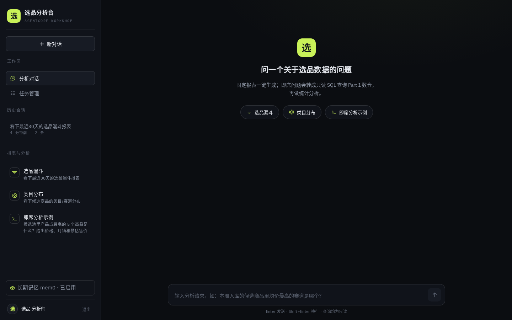
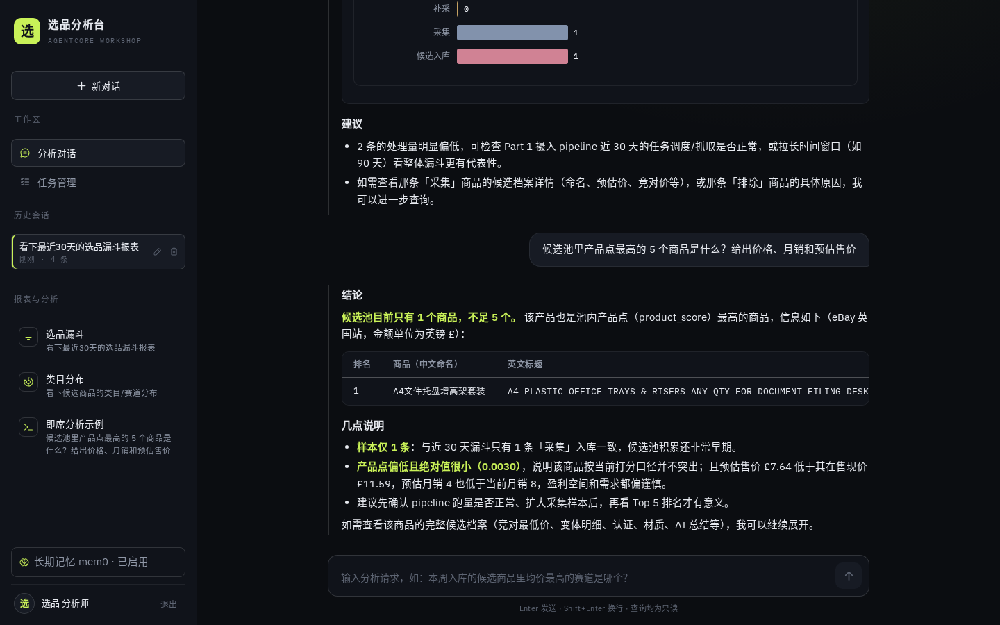
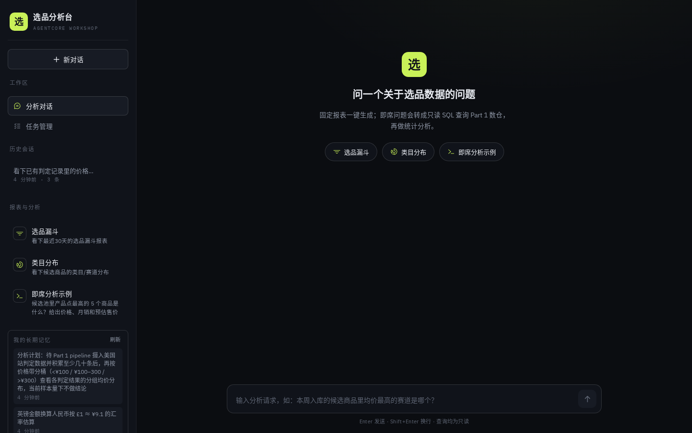

<!-- Copyright (c) 2026 Amazon.com and Affiliates. -->
<!-- SPDX-License-Identifier: CC-BY-4.0 -->

# Agent 的生产化之旅：Amazon Bedrock AgentCore 端到端实战（中国区 · 宁夏）

> 学员动手实验手册 · 区域：**中国（宁夏）cn-northwest-1**
> 本手册中的模型网关地址与 API key 均为占位符，**实际值由讲师现场提供**。

## 目录

- [一、前言](#一前言)
- [二、环境准备](#二环境准备)
- [三、场景一：选品数据摄入 Pipeline](#三场景一选品数据摄入-pipeline)
- [四、场景二：Web Chat 分析门户](#四场景二web-chat-分析门户)
- [资源清理](#资源清理)
- [排障速查](#排障速查)

---

## 一、前言

### 1. 实验内容

大模型应用正在从「对话问答」走向「交付结果」：不只是回答一个问题，而是接管一段
真实的业务流程。要把一个 demo 里的 Agent 变成生产系统，绕不开三个问题：

1. **运行时**：Agent 会话如何隔离？高并发怎么扩缩？长任务（几分钟到几小时）谁托管？
2. **工具安全**：Agent 要用浏览器、要跑代码、要查数据库——这些高危能力放哪里执行？
3. **身份与集成**：谁在调用 Agent？Agent 又以什么身份去调用下游系统？

Amazon Bedrock AgentCore 用五个托管组件回答这三个问题，可以理解为「Agent 界的
Serverless」：

| 组件 | 作用 |
|---|---|
| **Runtime** | Agent 托管运行时：会话级 microVM 隔离、按需扩缩、支持流式（SSE）与长任务 |
| **Browser** | 云端托管的真实浏览器：Agent 逛网页不落本地，支持 Live View 实况观看 |
| **Code Interpreter** | 安全代码沙箱：数值测算、统计分析在隔离环境执行，不许模型「心算」 |
| **Gateway** | 托管工具网关：把 Lambda / API 转成 MCP 工具，带 JWT 认证 |
| **Identity** | 入站认证与出站授权：用户 token 验证 + 机器凭证交换，Agent 拿不到数据库密码 |

业务场景是**跨境电商选品**：Agent 基于 [Strands Agents](https://strandsagents.com/)
框架实现，选品 SOP 以 Skill 形式插拔——换业务规则不改 Agent 代码。

### 2. 手册内容

| 场景 | 用到的 AgentCore 组件 | 预计耗时 |
|---|---|---|
| 场景一：选品数据摄入 Pipeline | Runtime、Browser、Code Interpreter | 部署约 10 分钟，单次调用 2~5 分钟 |
| 场景二：Web Chat 分析门户 | Runtime、Gateway、Identity、Code Interpreter、Browser Live View | 部署约 10 分钟 |

---

## 二、环境准备

### 1. 进入实验室环境

1. 点击实验页面左上方「开始实验」按钮，扫码进入实验环境。
2. 首次登录填写邮箱、勾选隐私协议，点「前往实验」。
3. 测试账号有效期一天，过期自动回收，无需手动清理。

（截图：实验平台登录与进入页面）

> 若使用**自有 AWS 账号**做实验，实验结束后请务必按[资源清理](#资源清理)删除资源。

### 2. LLM 模型访问准备

中国区（宁夏）没有可直接调用的默认大模型端点，本实验统一走一个 **OpenAI 兼容
模型网关**（标准 `/chat/completions` 与 `/embeddings` 接口）。需要两个模型：

| 用途 | 说明 | 示例形态 |
|---|---|---|
| 对话/推理模型 | 驱动 Agent 主流程，需支持工具调用（function calling） | `kimi-k3` 一类的推理模型 |
| Embedding 模型 | 场景二长期记忆的向量化，**维度须与部署一致（默认 1024）** | `titan-embed-text-v2`（1024 维） |

从讲师处获取三样东西（下文用占位符表示）：

- 模型网关地址：`<模型网关地址>`（形如 `https://xxxx.example.com`）
- API key：`<现场发放的 key>`
- 模型 ID：对话模型 `<对话模型名>`、embedding 模型 `<embedding 模型名>`

### 3. 实验室环境 IDE 登录

1. 登录 AWS 控制台（中国区：`https://console.amazonaws.cn`），确认右上角区域为
   **宁夏（cn-northwest-1）**。

   （截图：控制台右上角区域选择）

2. 顶部搜索框搜 **CloudFormation**，打开名为 `agentcore-workshop-base` 的堆栈，
   切到 **输出（Outputs）** 标签页。

   （截图：CloudFormation 堆栈输出页）

3. 点击 **IdePasswordConsoleUrl** 链接跳转 Secrets Manager，点「检索密钥值」，
   记下 `password` 字段——这是 IDE 登录密码。

   （截图：Secrets Manager 检索密钥值）

4. 回到 Outputs，用 **IdeUrl** 在浏览器打开 IDE（地址形如
   `http://<alb-dns>:8889`，**注意是 8889 端口的 HTTP 地址**——中国区未备案账号
   80/443 端口不可用，属正常现象），输入上一步的密码登录。

   （截图：code-server 登录页）

5. 登录后 IDE 已把 `~/environment` 设为工作目录，里面预置了
   `agentcore_cn_workshop` 项目代码。点左上角菜单 ≡ → Terminal → New Terminal
   打开命令行。

   （截图：IDE 文件树与 Terminal）

> 页面打不开时优先换网络（如手机热点）：部分企业办公网只放行 80/443 出站，
> 会拦掉 8889 这类非标准端口。

### 4. 配置模型环境

在 IDE 左侧文件树打开 `agentcore_cn_workshop/.env`，把尖括号占位符替换为
讲师提供的实际值并保存（**整个实验只需填这一次**）：

```bash
export OPENAI_BASE_URL=<模型网关地址>/v1
export OPENAI_API_KEY=<现场发放的 key>
export MODEL_ID=<对话模型名>

# 场景二的长期记忆（现在一并填好，后面不用再回来）
export MEM0_LLM_MODEL=<对话模型名>
export MEM0_LLM_BASE_URL=<模型网关地址>/v1
export MEM0_LLM_API_KEY=<现场发放的 key>
export MEM0_EMBEDDER_MODEL=<embedding 模型名>
export MEM0_EMBEDDER_DIMS=1024

# 场景二的身份系统（中央 Keycloak，讲师随模型网关一并发放）
export KC_URL_OVERRIDE=<Keycloak 地址>
export AGENT_CLIENT_SECRET=<client secret>
export ANALYST_PASSWORD=<analyst 密码>
export VIVIAN_PASSWORD=<vivian 密码>
export MARCO_PASSWORD=<marco 密码>
```

> 所有步骤脚本会自动读取这个文件，**任何 Terminal 都无需手动 export**；
> 终端里已 export 的同名变量优先于文件值；没填的占位符行自动跳过，
> 漏填时脚本会明确提示缺什么。文件已被 git 忽略，key 不会被提交。

---

## 三、场景一：选品数据摄入 Pipeline

> 让 Agent 接管一条真实的选品 SOP：逛 eBay 采集商品数据 → 沙箱测算 → 判定入库。

### 1. 心智模型：通用 Agent + 可插拔 SOP

- `agent/main.py` 是一个**不懂业务**的「选品专员」：只带三样通用能力——
  AgentCore Browser（逛网页）、Code Interpreter（算数）、写库工具。
- `agent/skills/product-selection-ebay/SKILL.md` 是**业务 SOP**：怎么搜索、
  跳过哪些商品、如何估算月销、什么条件判定采集，全部写在 Skill 里。
- Strands 的 AgentSkills 插件会加载 `agent/skills/` 下所有 SKILL.md。预置三份：
  `product-selection-ebay`（eBay 英国站，默认）、`product-selection-ebay-us`
  （明确说美国站时）、`product-selection`（Amazon，数据中心 IP 被硬封锁，仅参考）。

Agent 的四类能力约定：

| 能力 | 约定 |
|---|---|
| AgentCore Browser | 逛 eBay 搜索与详情页；跳过 SPONSORED/二手/翻新；读标题、一口价、销量、品牌、卖家、变体等 |
| Code Interpreter | 月销与上架时间估算、门槛比较、产品点公式——**不许心算** |
| `save_verdict` | 每个处理过的商品必写一条判定：PASS / 排除 / 补采 / 采集 |
| `save_candidate` | 仅判定为「采集」时写入完整候选档案 |

原则：数据拿不到宁判「补采」，**不得编造**。

### 2. 一键部署

在 IDE Terminal 执行（模型配置自动来自 `.env`）：

```bash
bash ~/environment/agentcore_cn_workshop/scripts/02_run_scenario1.sh
```

脚本约 5~10 分钟，依次完成：写库 Lambda 与建表（基础环境）、自定义 Browser 与
Profile、Agent 部署到 AgentCore Runtime（direct code deploy，无需 Docker）、
一次冒烟调用。

（截图：02 脚本部署完成输出）

### 3. 单独调用 Agent 跑一次选品

```bash
source ~/environment/agentcore_cn_workshop/.venv/bin/activate
source ~/environment/agentcore_cn_workshop/part1_data_ingestion/scripts/cn_env.sh
cd ~/environment/agentcore_cn_workshop/part1_data_ingestion/agent
agentcore invoke '{"prompt": "从 eBay 英国站搜索 desk organizer 选品，按 Best Match 顺序处理前 2 个非广告、一口价、全新商品；跳过广告、拍卖、二手和翻新商品且不占名额。严格按 product-selection-ebay SOP 完成页面取数、月销估算、市场结构与黑名单判定、Code Interpreter 经济测算，并对每个已处理商品立即调用 save_verdict 入库；判定为采集时再调用 save_candidate。抓取失败按 SOP 写补采，不得编造数据。最后汇总处理数、各 verdict 数量、入库结果和候选产品点。"}'
```

> `cn_env.sh` 把 AgentCore SDK 的端点指向中国区（`agentcore invoke`/`status`
> 这类交互命令需要；02 部署脚本内部已自动处理）。完整处理一个商品约 2~5 分钟。
> 推理类模型（如 kimi）会先流式输出一段「思考过程」再给正式内容，属正常现象。

想多采几条数据，可再跑以下提示词（覆盖 UK/US 两个站点，注意 SOP 名与 site 参数）：

**US / drawer organizer**

```text
从 eBay 美国站（ebay.com，US）搜索 drawer organizer 选品，按 Best Match 顺序处理前 2 个非广告、一口价、全新商品；跳过广告、拍卖、二手和翻新商品且不占名额。严格按 product-selection-ebay-us SOP 完成页面取数、月销估算、市场结构与黑名单判定、Code Interpreter 经济测算，并对每个已处理商品立即调用 save_verdict 入库，site=US；判定为采集时再调用 save_candidate。抓取失败按 SOP 写补采，不得编造数据。最后汇总处理数、各 verdict 数量、入库结果和候选产品点。
```

**UK / cable organizer**

```text
从 eBay 英国站（ebay.co.uk）搜索 cable organizer 选品，按 Best Match 顺序处理前 2 个非广告、一口价、全新商品；跳过广告、拍卖、二手和翻新商品且不占名额。严格按 product-selection-ebay SOP 完成页面取数、月销估算、市场结构与黑名单判定、Code Interpreter 经济测算，并对每个已处理商品立即调用 save_verdict 入库，site=UK；判定为采集时再调用 save_candidate。抓取失败按 SOP 写补采，不得编造数据。最后汇总处理数、各 verdict 数量、入库结果和候选产品点。
```

**US / travel organizer**

```text
从 eBay 美国站（ebay.com，US）搜索 travel organizer 选品，按 Best Match 顺序处理前 2 个非广告、一口价、全新商品；跳过广告、拍卖、二手和翻新商品且不占名额。严格按 product-selection-ebay-us SOP 完成页面取数、月销估算、市场结构与黑名单判定、Code Interpreter 经济测算，并对每个已处理商品立即调用 save_verdict 入库，site=US；判定为采集时再调用 save_candidate。抓取失败按 SOP 写补采，不得编造数据。最后汇总处理数、各 verdict 数量、入库结果和候选产品点。
```

（截图：agentcore invoke 处理过程与汇总输出）

### 4. 验证入库结果

数仓在私有 VPC 内（中国区没有 RDS Data API），查询统一经 VPC 内的数据面
Lambda `agentcore-workshop-db`：

```bash
cd ~/environment/agentcore_cn_workshop/
aws lambda invoke --function-name agentcore-workshop-db --region "$AWS_REGION" \
  --cli-binary-format raw-in-base64-out \
  --payload '{"op":"execute","args":{"sql":"SELECT verdict, reason, product_title, product_score FROM selection_verdicts ORDER BY created_at DESC LIMIT 10","params":{}}}' \
  /dev/stdout
```

（截图：判定记录查询返回）

---

## 四、场景二：Web Chat 分析门户

> 把场景一采集的数据变成一个带登录、带长期记忆、可调度任务的分析门户。

三个关键设计，用生活化比喻理解：

- **「工牌」**：用户先在 Keycloak（自部署 OIDC IdP，跑在 ECS Fargate 上，HTTPS
  入口由 API Gateway 提供）登录拿 JWT，AgentCore Runtime 只认带工牌的请求。
- **「不能直接进机房」**：Agent 不碰数据库。Gateway 把 VPC 内的数据查询 Lambda
  转成 3 个 MCP 工具（选品漏斗、类目分布、即席只读 SQL）；Runtime 经 Identity
  用机器凭证换 Gateway 的 token——两段 token 用 audience 隔离。
- **「记得住客户」**：自部署 mem0 长期记忆，按登录用户隔离；向量存 Aurora
  pgvector，读写经 VPC 内记忆 Lambda。

```
浏览器 SPA ──① OIDC 登录(PKCE)──▶ Keycloak（ECS Fargate + API Gateway）
    │
    ② 用户 token（aud=analysis-runtime）
    ▼
AgentCore Runtime（JWT 入站认证，SSE 流式）
    │  ├── Code Interpreter（统计测算）
    │  ├── db Lambda（会话历史回灌/落库）
    │  └── mem0 ──▶ 记忆 Lambda ──▶ Aurora pgvector
    ③ Identity M2M 换 token（aud=analysis-gateway）
    ▼
Gateway（MCP）──▶ 数据查询 Lambda（VPC 内）──▶ Aurora
```

### 4.1 启用长期记忆 mem0 并部署基础环境

长期记忆的 `MEM0_*` 配置在「环境准备」第 4 步已随 `.env` 一并填好，脚本会
自动读取，此处无需任何 export。若当时跳过了 MEM0 部分，现在回到
`agentcore_cn_workshop/.env` 补填并保存即可。

> embedding 维度需 ≤ 2000；若你的 embedding 模型不是 1024 维，把
> `MEM0_EMBEDDER_DIMS` 改成实际维度（维度决定向量表结构，换模型要换表）。
> 不配置 MEM0 这组值也能部署——长期记忆整体禁用，对话功能不受影响。

然后一键部署：

```bash
cd ~/environment/agentcore_cn_workshop/
bash scripts/03_run_scenario2.sh
```

脚本约 8 分钟：Keycloak 直接复用（realm 镜像与服务副本在建栈时已就绪，
脚本只等它在线）、Gateway 与 3 个 MCP
工具、Identity 凭证提供方、分析 Agent Runtime、门户前端配置。**保存输出末尾
打印的门户地址**（`HttpPortalUrl`，形如 `http://<nlb-dns>:5173`）。

（截图：03 脚本部署完成输出）

部署完成后，点 Terminal 右上角 `+` 新开一个 Terminal 启动前端（保持运行）：

```bash
cd ~/environment/agentcore_cn_workshop/part2_chat_portal/web && npm run dev
```

### 4.2 长期记忆——三个分析师的对比演示

先给两个演示账号种入人设记忆（`analyst` 留空做对照）。**新开一个 Terminal**：

```bash
cd ~/environment/agentcore_cn_workshop/part2_chat_portal
source ~/environment/agentcore_cn_workshop/.venv/bin/activate
source ~/environment/agentcore_cn_workshop/scripts/00_env.sh   # 自动加载 .env 里的 MEM0_* 配置
python3 scripts/seed_memories.py
```

三个账号的密码就是「环境准备」第 4 步填进 `.env` 的那三个（全场统一，讲师发放）。
忘了的话也可以从部署产物里查（不入 git）：

```bash
grep -E 'ANALYST_PASSWORD|VIVIAN_PASSWORD|MARCO_PASSWORD' \
  ~/environment/agentcore_cn_workshop/part2_chat_portal/.deploy/secrets.env
```

用 4.1 保存的门户地址在浏览器打开（HTTP + 5173 端口，中国区免备案形态），
依次体验：

#### 4.2.1 分析师一：analyst（无记忆基线）

- **固定报表**：点侧栏「选品漏斗」「类目分布」——走 Gateway 预置 MCP 工具，
  表格 + 图表流式返回。
- **即席分析**：输入 `候选池里产品点最高的 5 个商品是什么？给出价格、月销和预估售价`
  ——Agent 生成只读 SQL（仅 SELECT、单条语句、最多 500 行）经 Gateway 执行。
- **会话内多轮**：追问 `第一名的商品为什么判 PASS？`——上下文在会话内延续。





#### 4.2.2 分析师二：vivian（资深买手人设）

- 左下角打开「我的长期记忆」面板：能看到预置的分析偏好（站点、币种、月销门槛
  等）——记忆按登录用户隔离。
- 直接问：`看下已有判定记录里的价格分布，按判定结果分组给我看看均价`——注意
  回答自动套用了她的偏好（站点过滤、币种换算），这些条件**不在问题里，来自记忆**。



#### 4.2.3 分析师三：marco（风控合规人设）

- 侧栏底部「退出」，换 `marco` 登录。记忆面板是他自己的 5 条偏好，与 vivian
  互不可见。
- 问同一个问题，回答口径明显不同：英镑原币、注明汇率、结论附数据来源。

（截图：marco 记忆面板与不同口径的回答）

#### 4.2.4 现场沉淀 analyst 的记忆

1. 换 `analyst` 登录（记忆面板为空）。
2. 发送：`记住我的分析偏好：金额一律换算成人民币，我只关注英国站`。
3. 等流式回复结束后 mem0 后台提取记忆（输入框解锁会晚几秒）。
4. 点「新对话」，再问一个业务问题——偏好已生效；刷新记忆面板可见新条目。

> 提取范围刻意收窄：只有分析偏好、身份职责、长期规则这类跨会话仍成立的
> 事实会沉淀；普通业务提问与查询结果不写入记忆，面板不会被问答记录淹没。
> 同一偏好再说一遍不会新增条目（已有的那条就是它），记忆一律用中文记录。

（截图：偏好沉淀前后对比）

### 4.3 Web 端管理数据摄取任务

场景一的摄入任务原本只能命令行 `agentcore invoke` 发起，门户的「任务管理」把它
产品化：

1. 新建任务：任务名 `DCV 演示 · storage box`，国家/站点保留 **UK**，摄入指令：

   ```text
   从 eBay 英国站搜索 storage box 选品，按 Best Match 顺序处理前 2 个非广告、一口价、全新商品；跳过广告、拍卖、二手和翻新商品且不占名额。严格按 product-selection-ebay SOP 判定并逐个入库。
   ```

2. 调度模式选「一次性 · 创建后立即执行」，点「创建并立即执行」。
3. 打开运行详情：状态「排队中」→「运行中」，时间线出现 `skills`、`browser`、
   `code_interpreter` 工具调用，右侧「关键日志」流式输出——这是一个独立的
   Runtime 会话。
4. 状态「运行中」时点 **「打开实况」**：经 Amazon DCV 直连 AgentCore 托管的
   Chromium，**实时**看 Agent 逛 eBay（不是录屏）。

（截图：任务创建 / 运行时间线 / DCV 实况）

---

## 资源清理

- **实验室环境**：无需清理，账号到期自动回收。
- **自有账号**：控制台 → CloudFormation（宁夏区）→ 选择堆栈
  `agentcore-workshop-base` → 右上角「删除」。删除钩子会一并清理场景脚本创建的
  Runtime、Browser、Gateway、Keycloak 子栈等全部 workshop 资源。

---

## 排障速查

| 现象 | 处理 |
|---|---|
| IdeUrl / 门户地址打不开 | 换网络（手机热点）；企业办公网常拦非标准端口（8889/5173） |
| 02/03 脚本报「缺少模型 API key」 | 检查 `agentcore_cn_workshop/.env` 是否已把尖括号占位符替换为实际值并保存 |
| `agentcore invoke` 报端点/超时错误 | 先 `source part1_data_ingestion/scripts/cn_env.sh`（中国区 SDK 端点覆盖） |
| 门户登录 403 | Keycloak 刚部署完 discovery 缓存未热，等 1~2 分钟重试 |
| 记忆面板始终为空 | 检查 4.1 的 `MEM0_*` 是否在**部署所在 Terminal** export 过；维度与模型不符时记忆自动禁用（看 03 输出提示） |
| Agent 逛 eBay 很慢 | 跨境访问波动属正常；单商品 2~5 分钟，耐心等流式输出 |
| 门户提问后「分析中」较久 | 推理类模型思考 + MCP 工具查询叠加，固定报表约 1~2 分钟出全量结果，不要重复点击 |
