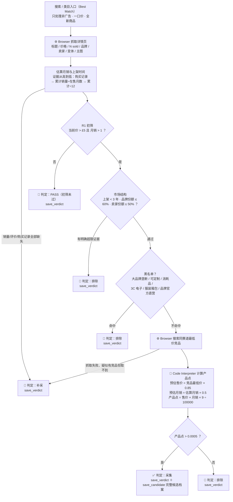

# 场景 1：选品数据摄入 Pipeline —— 让 Agent 接管一条真实的选品 SOP

在这个实验里，你将部署并调用本 Workshop 的第一个 Agent：`product_ingestion_agent`。
给它一句话——"从 eBay 英国站搜索 desk organizer 选品，处理前 2 个非广告商品"——
它会自己打开浏览器逛 eBay、翻商品详情页和购买记录、调研同赛道竞品、在代码沙箱里
跑经济测算，最后把每一个商品的判定结果写进 Aurora 数仓。整个过程你不需要写一行
爬虫代码或规则引擎。

## 心智模型：一位新员工 + 一本 SOP 手册

你可以把这个 Agent 理解为**"一位新入职的选品专员，外加一本公司发的 SOP 手册"**：

- **专员本人**（`agent/main.py`）只带三样通用办公装备：AgentCore **Browser**
  （浏览器）、**Code Interpreter**（计算器）和写库工具（录入系统）。他不懂任何
  选品业务。
- **SOP 手册**（`agent/skills/product-selection-ebay/SKILL.md`）写的才是业务：
  去哪个站点、抓哪些字段、按什么顺序过滤、用什么公式测算、结果怎么录入。
  它不是一段独立运行的 Python 程序，也不是新的工具，而是一份**交给模型执行的
  业务 SOP**——`main.py` 用 Strands 的 `AgentSkills` 插件加载 `agent/skills/`
  下所有 `SKILL.md`，模型先根据每份 Skill 头部的 `name` / `description` 匹配任务，
  再把正文里的取数口径、判定顺序和公式当作硬性规则执行。

这带来一个重要的架构性质：**换业务不用换人**。要做竞品监控、价格追踪，新写一本
`SKILL.md` 放进 `skills/` 目录即可，Agent 代码零改动。本实验默认加载的手册是
eBay 英国站选品流程；用户明确说 eBay US / `ebay.com` 时改用
`product-selection-ebay-us`，明确说 Amazon 时才用 `product-selection`——三份
Skill 共享同一种"抓取 → 过滤 → 测算 → 入库"骨架，只是站点、币种和部分阈值不同。

## 三类能力如何分工

| 能力 | 在本 Skill 中的职责 |
|------|---------------------|
| AgentCore Browser | 打开 eBay UK 搜索页和详情页，跳过 `SPONSORED` 广告及二手/翻新品；读取标题、一口价、`N sold`、购买记录、品牌、卖家、变体、材质和主图，并搜索同赛道竞品 |
| Code Interpreter | 用 Python 估算月销和上架时间，执行门槛比较及产品点公式；Skill 明确要求**不能心算**，以便计算过程可审计 |
| `save_verdict` | 每处理完一个商品**立即**写入一条判定，包括早期过滤掉的 `PASS`、`排除`、`补采` 和最终的 `采集` |
| `save_candidate` | 只有判定为 `采集` 时才调用，写入价格、月销、竞品、产品点、图片、变体、认证需求和 AI 总结等完整候选档案 |

## 一件商品的决策流水线

每个商品从进入视野到落库，都要走完下面这条流水线。注意两点：**每个出口都会写一条
判定记录**（`save_verdict`），早期淘汰的商品也有迹可查；数据拿不到时宁可判
`补采`，**绝不编造数值**。

四种判定的含义（`PASS` 最容易误解）：

| verdict | 含义 |
|---------|------|
| `PASS` | **R1 初筛未过**（价格 ≤ £5 或月销 ≤ 1）——它不是"通过并进入候选池"，而是项目沿用的初筛淘汰状态 |
| `排除` | 市场结构超限、命中黑名单、或产品点不达标 |
| `补采` | 关键数据取不到（宁可补采，不编数据）；即使整次任务一个商品都识别不了，也必须写一条 `补采` 说明原因，不能无记录结束 |
| `采集` | 全链路通过，同时写入完整候选档案（`save_candidate`） |

关于产品点公式的两个细节：同赛道竞品要求功能、用途和核心卖点相同（颜色或小规格
差异仍算同赛道），取全新一口价中的最低价；若确认市场上没有同赛道竞品，允许用
当前价代替，但候选必须标注"存疑·待人工补竞品"。月销 `> 1` 与产品点 `> 0.0005`
（约 50 元/月销售额）是为了 Demo 扩大可演示样本量而设置的宽松阈值，不代表生产
选品标准。

## 动手观察点

跑完部署脚本、发起一次调用后，别急着只看最终汇总——按下面三个观察点确认
Agent 确实在**按 SOP 执行**，而不是"看起来在执行"：

1. **看工具调用轨迹**：调用输出里应能看到 Browser 打开搜索页/详情页的动作，
   以及 Code Interpreter 里真实的 Python 计算过程（Skill 明确要求不能心算，
   所以门槛比较和产品点公式都应出现在沙箱代码里）。
2. **查判定记录**：用运行手册场景 1 一节的验证命令查 `selection_verdicts` 表，
   对照流程图检查每条记录的 `verdict` 与 `reason`——被 `PASS`/`排除` 的商品，
   原因是否落在流水线对应的关卡上？月销估算用的是三种证据口径中的哪一种？
3. **改一次 SOP**：打开 `SKILL.md`，把产品点门槛从 `0.0005` 调高一个数量级，
   重跑一遍场景 1 部署脚本（幂等，`SKIP_SMOKE=1` 可跳过自动冒烟）重新发布后
   再调用——原本 `采集` 的商品应变成 `排除`。这就是"业务用 Skill 插拔"的直观
   体验：策略迭代不碰 Agent 代码。注意已部署的 Runtime 不会自动读取工作区的
   修改，改完必须重新发布才生效。
