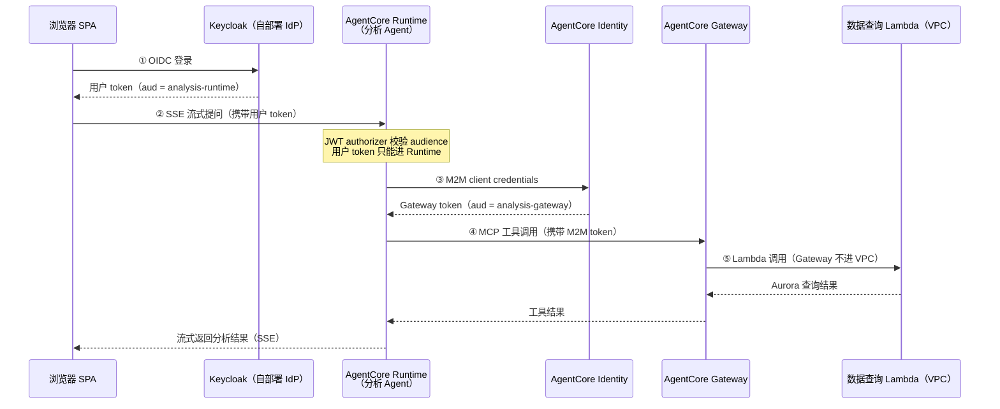

# 场景 2 介绍：Web Chat 分析门户 —— 给 Agent 发工牌、配网关、加记忆

场景 1 结束后，数仓里已经躺着一批选品判定和候选档案。这个场景要把它们交到
业务方手里：一个**能登录的 Web 分析门户**——运营同学用自然语言提问「看下最近
30 天的选品漏斗」，Agent 查库、统计、画表，流式返回；还能在门户里把场景 1 的
摄入任务做成定时调度，并通过浏览器实况亲眼看 Agent 逛 eBay。

场景 1 的主角是 Runtime、Browser 和 Code Interpreter；这个场景的主角是
AgentCore 家族剩下的两个组件：**Gateway** 和 **Identity**。

## 心智模型：把一位分析师顾问接入公司系统

场景 1 的 Agent 像一位独立干活的选品专员——给任务、干活、交结果，调用方只有
你自己。场景 2 则要把一位**分析师顾问接入公司系统，对全公司提供服务**，这立刻
带来三个新问题：

- **他得有工牌**：谁能找他咨询？用户要先登录（自部署 Keycloak，OIDC/PKCE），
  Agent 只接待持有效工牌（JWT）的请求——这是 Runtime 的**入站认证**。
- **他不能直接进机房**：查数据必须走公司统一的工具窗口。**Gateway** 把 VPC 内
  的数据查询 Lambda 转换成 3 个标准 MCP 工具（选品漏斗、类目分布、即席只读
  SQL），Agent 凭 **Identity** 换取的机器凭证（M2M token）调用——这是**出站
  授权**。Agent 从头到尾接触不到数据库凭证。
- **他要记得住客户**：不同分析师有不同口味（站点、币种、过滤门槛）。自部署的
  mem0 长期记忆按登录用户隔离，跨会话生效。

## 架构与认证链

```
浏览器（React SPA）
   │ ① OIDC 登录（Authorization Code + PKCE / HTTP 门户自动退回授权码流程）
   ▼
Keycloak（自部署 IdP：ECS Fargate + API Gateway 免域名 HTTPS 入口）
   │ ② 用户 token（audience = analysis-runtime）
   ▼
AgentCore Runtime（分析 Agent，JWT 入站认证，SSE 流式输出）
   ├──▶ AgentCore Identity ── ③ M2M 换取 Gateway token（audience = analysis-gateway）
   ├──▶ AgentCore Gateway（MCP 工具，JWT 入站认证）
   │        └──▶ 数据查询 Lambda（挂 Aurora 同 VPC）──▶ Aurora
   ├──▶ Code Interpreter（统计分析）
   ├──▶ db Lambda（VPC）──▶ 会话历史表（对话落库；沙箱回收后回灌）
   └──▶ mem0 长期记忆 ──▶ 记忆向量 Lambda（VPC）──▶ Aurora pgvector
```

认证链是理解这个场景的关键——**两段 token，audience 隔离**：



## 四个设计点

1. **两段认证，audience 隔离**。Keycloak 里两个 client 各配 audience mapper：
   前端用户 token 带 `analysis-runtime`，Agent 通过 Identity 换出的 M2M token
   带 `analysis-gateway`。Runtime 和 Gateway 的 JWT authorizer 各收各的票——
   **用户 token 拿不到 Gateway 的门票**。
2. **Gateway 零 VPC egress**。Gateway 本身不进 VPC，私网访问全部由挂在 Aurora
   同 VPC 的 Lambda 承担，Gateway 只负责把 Lambda 转成 MCP 工具——与场景 1
   「计算留公网、私网访问全交 VPC 内 Lambda」是同一个设计哲学，也是整套代码
   能在中国区原样部署的关键之一。
3. **全链路流式**。Agent 入口是 async generator，Runtime 自动转 SSE；打字机
   效果从模型一路流到浏览器。
4. **长期记忆自部署 mem0**（不用 AgentCore 托管 Memory）。新会话首轮按用户
   检索记忆注入上下文，每轮结束交 mem0 做 LLM 事实提取写回；计算面（提取 LLM
   + embedding）留在公网 Runtime，向量面经 Lambda 下沉到 VPC 内的 Aurora
   pgvector——换个 OpenAI 兼容端点即可在中国区复用。

## 你将体验到什么

- **三类分析对话**：固定报表（Gateway 预置工具）→ 即席分析（自然语言转只读
  SQL）→ 会话内多轮追问（沙箱内存 + 数仓回灌的两层历史，上下文不断档）。
- **长期记忆对比演示**：`vivian`（资深买手）和 `marco`（风控合规）问同一个
  问题，得到口径完全不同的回答——站点、币种、过滤门槛全部来自各自的记忆。
- **任务管理 + 浏览器实况**：在门户里把场景 1 的摄入任务做成一次性/定时调度，
  通过 Amazon DCV **实时**看 AgentCore Browser 正在访问的 eBay 页面（不是
  录屏），运行结束后复盘本次入库明细。

动手部署与逐步操作见[场景 2 操作手册](场景2操作手册.md)。
