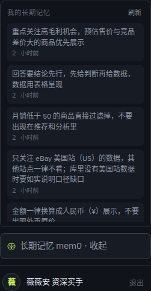
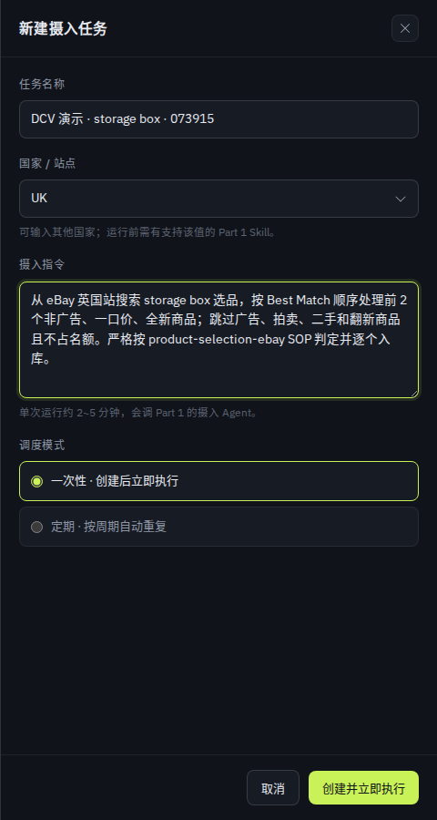
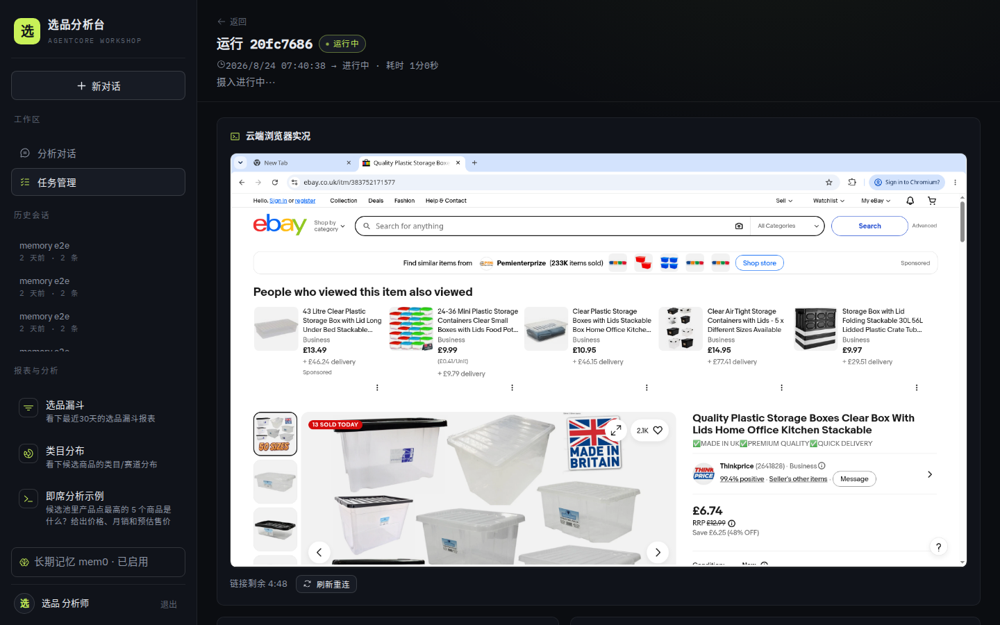
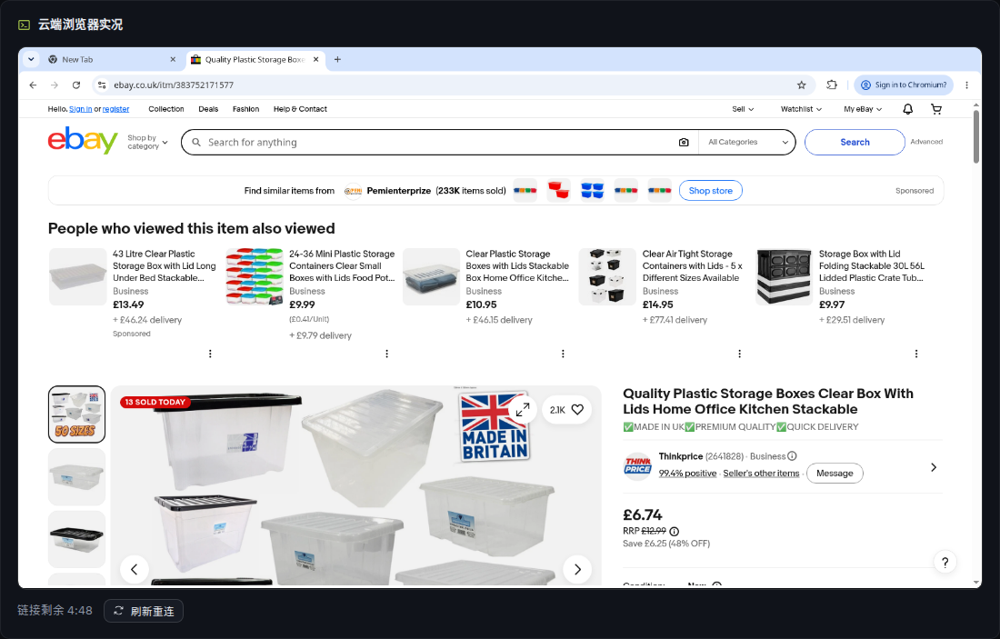

# Amazon Bedrock AgentCore 实验手册（中国区 · 宁夏）

本手册带你完成两个连贯的实验，跑通 AgentCore 产品家族的核心组件：

| 实验 | 内容 | 用到的组件 | 预计耗时 |
|------|------|-----------|---------|
| 实验一 | 选品数据摄入 Pipeline：Agent 爬 eBay 商品、做经济测算、判定入库 | Runtime、Browser、Code Interpreter | 部署约 10 分钟，单次调用 2~5 分钟 |
| 实验二 | Web Chat 分析门户：登录后用自然语言分析实验一入库的数据，并在门户里创建/调度/观察实验一的摄入任务 | Runtime、Gateway、Identity、Code Interpreter、Browser Live View | 部署约 10 分钟 |

两个实验共用一套数仓（Aurora Serverless v2），实验二依赖实验一的部署产物，请按顺序完成。

本手册是**动手主线**：架构详解与设计决策见 [docs/架构与设计.md](docs/架构与设计.md)，
中国区分区差异与实测结论见 [docs/中国区移植说明.md](docs/中国区移植说明.md)。
参加现场活动（预置 CloudLab 环境）的学员请直接使用
[agentcore_cn_hands_on/中国区实验手册.md](agentcore_cn_hands_on/中国区实验手册.md)。

## 环境准备

- AWS 账号。**区域是唯一开关**：中国区用 `cn-northwest-1`（宁夏，AgentCore
  已上线并经本仓库全量实测），海外用 `us-west-2`——部署脚本按 `AWS_REGION`
  自动推导 ARN 分区（`arn:aws-cn`）、域名后缀（`.amazonaws.com.cn`）与
  AgentCore SDK 端点覆盖等差异
- 模型前置（两种形态二选一，模型统一走标准 OpenAI 兼容 Chat Completions）：
  - **中国区（本手册主线）**：准备一个区内可达的 OpenAI 兼容模型网关，拿到
    端点、key 与模型名，用三元组环境变量注入。需支持工具调用（function
    calling）；启用实验二长期记忆还需一个 embedding 模型（如 1024 维的
    titan-embed-text-v2 一类）。宁夏区没有原生 Bedrock 模型服务，模型必须
    走这种形态
  - **全球区**：在 Bedrock 控制台开通 **OpenAI GPT-5.6** 模型访问，并生成
    Bedrock API key（控制台路径：Bedrock → API keys），默认走 bedrock-mantle
    端点
- 本机工具：Python 3.10+、AWS CLI（已 `aws configure`）、Docker（实验二构建
  Keycloak 镜像用）、Node.js 18+（实验二前端用）

```bash
# 确认凭证与区域（区域是唯一开关）
aws sts get-caller-identity
export AWS_REGION=cn-northwest-1   # 海外区改 us-west-2

# 模型认证（key 必填，按上面的形态二选一）
# 形态一（中国区主线）：三元组指向区内 OpenAI 兼容模型网关
export OPENAI_BASE_URL=<模型网关地址>/v1
export OPENAI_API_KEY=<key>
export MODEL_ID=<对话模型名>
# 形态二（全球区默认 bedrock-mantle）：Bedrock API key 走标准环境变量
# export AWS_BEARER_TOKEN_BEDROCK=<Bedrock API key>

# 安装 AgentCore 部署工具链（uv 是 direct_code_deploy 打包依赖的硬前置）
pip install bedrock-agentcore-starter-toolkit uv
```

> 注意：`OPENAI_API_KEY` 的优先级高于 `AWS_BEARER_TOKEN_BEDROCK`。未配置
> `OPENAI_BASE_URL` 时走默认 bedrock-mantle 端点，key 必须是 Bedrock API key
> （ABSK 前缀），且**中国区没有默认端点，必须配三元组**（部署脚本会
> fail-fast 校验）；显式配置了 `OPENAI_BASE_URL` 则按成对的 key 原样采用，
> 注意部署机环境卫生（指向 localhost/私网 IP 的 `OPENAI_BASE_URL` 会被脚本
> 直接拒绝——公网 Runtime 访问不到）。

---

## 实验一：选品数据摄入 Pipeline

### 架构

```
调用方（CLI / 定时任务）
   │ InvokeAgentRuntime
   ▼
AgentCore Runtime ── Strands Agent + 选品 SOP Skill
   ├──▶ AgentCore Browser ──▶ eBay 商品页（爬取价格/销量/卖家）
   ├──▶ Code Interpreter    （沙箱内跑经济测算）
   └──▶ lambda.invoke ──▶ 写库 Lambda（挂 Aurora 同 VPC）
                              └──▶ pg8000:5432 ──▶ Aurora Serverless v2
                                   （判定与候选档案入库）
```

三个设计点（详解见 [docs/架构与设计.md](docs/架构与设计.md)）：

1. **业务逻辑用 Skill 插拔**：Agent 本体只有通用能力（爬取、计算、入库），
   选品 SOP 全部写在 `agent/skills/product-selection-ebay/SKILL.md` 里，
   新增场景只加 Skill 目录、Agent 代码零改动。Skill 的取数口径、决策流水线
   与产品点公式详见设计文档的「Skill 如何工作」一节——排查判定结果前建议
   先读它。
2. **Agent 不挂 VPC，私网访问交给 Lambda**：入库只做一次 `lambda.invoke`，
   由 Aurora 同 VPC 内的写库 Lambda pg8000 直连。不用 RDS Data API——
   中国区没有该服务，数据面统一用两分区都可用的形态。
3. **Browser 带 Web Bot Auth**：云端真实 Chromium + 请求签名过反爬验证；
   Profile 跨会话保留 cookies。亚马逊对数据中心 IP 硬封锁，默认站点选 eBay。

### 1. 部署

```bash
cd part1_data_ingestion
bash scripts/deploy.sh
```

脚本幂等，可重复执行，依次完成：

1. CloudFormation 建 Aurora Serverless v2（自建 VPC，Min 0.5 ACU warm standby）
   与 Secrets Manager 接口端点、写库 Lambda 的执行角色
2. 打包部署写库 Lambda（挂私有子网，pg8000 直连集群 5432）
3. 建表（invoke 写库 Lambda 的 `setup_tables`）：业务两表 `selection_verdicts`
   （判定记录）、`product_candidates`（候选档案），以及实验二门户要用的任务管理
   三表和会话历史两表（都建在这套共享数仓里）
4. 创建自定义 Browser（Web Bot Auth）与 Browser Profile
5. `agentcore configure --deployment-type direct_code_deploy && agentcore launch`
   把 Agent 代码直接部署到 Runtime（依赖由 `uv` 本机打包，无需 Docker、不经
   CodeBuild——中国区没有 CodeBuild ARM_CONTAINER，该形态两分区通用）
6. 给 Runtime 执行角色附加写库 Lambda 与 Browser 的访问策略

> 如果这套环境之前部署过（实验二也跑过），本次升级要**先跑一遍实验二的
> `part2_chat_portal/scripts/deploy.sh`** 再跑上面的命令：Secrets Manager 接口
> 端点的归属从实验二的栈挪到了实验一的 Aurora 栈（端点随 VPC 走），而同一 VPC
> 对同一服务只允许一个 Private DNS 端点，得先让实验二把旧的删掉。顺序反了实验一
> 的脚本会在部署前预检报错并提示。全新环境按手册顺序做即可，无此问题。

### 2. 调用 Agent 跑一次选品

```bash
cd agent
# 中国区：agentcore invoke / status 这类交互命令先做一次 SDK 端点覆盖
#（deploy.sh 内部已自动处理；海外区执行是空操作）
source ../scripts/cn_env.sh
agentcore invoke '{"prompt": "从 eBay 英国站搜索 desk organizer 选品，按 Best Match 顺序处理前 2 个非广告、一口价、全新商品；跳过广告、拍卖、二手和翻新商品且不占名额。严格按 product-selection-ebay SOP 完成页面取数、月销估算、市场结构与黑名单判定、Code Interpreter 经济测算，并对每个已处理商品立即调用 save_verdict 入库；判定为采集时再调用 save_candidate。抓取失败按 SOP 写补采，不得编造数据。最后汇总处理数、各 verdict 数量、入库结果和候选产品点。"}'
```

完整处理一个商品（详情页 + 竞品调研 + 测算 + 入库）约 2~5 分钟，
每次调用建议处理 1~3 个。推理类模型（如 kimi）会先流式输出一段思考过程再给
正式内容，属正常现象。更多玩法（类目浏览、指定 URL 判定）见
`scripts/invoke_example.sh`。

#### 本次真实入库使用的完整提示词

以下四条提示词已在 Runtime 发布后实际执行，覆盖 UK/US 两个站点。复制时不要省略
站点、商品条件和逐商品入库要求，避免模型误选 Skill 或无记录结束。

**UK / desk organizer**

```text
从 eBay 英国站（ebay.co.uk）搜索 desk organizer 选品，按 Best Match 顺序处理前 2 个非广告、一口价、全新商品；跳过广告、拍卖、二手和翻新商品且不占名额。严格按 product-selection-ebay SOP 完成页面取数、月销估算、市场结构与黑名单判定、Code Interpreter 经济测算，并对每个已处理商品立即调用 save_verdict 入库，site=UK；判定为采集时再调用 save_candidate。抓取失败按 SOP 写补采，不得编造数据。最后汇总处理数、各 verdict 数量、入库结果和候选产品点。
```

**US / drawer organizer**

```text
从 eBay 美国站（ebay.com，US）搜索 drawer organizer 选品，按 Best Match 顺序处理前 2 个非广告、一口价、全新商品；跳过广告、拍卖、二手和翻新商品且不占名额。严格按 product-selection-ebay-us SOP 完成页面取数、月销估算、市场结构与黑名单判定、Code Interpreter 经济测算，并对每个已处理商品立即调用 save_verdict 入库，site=US；判定为采集时再调用 save_candidate。抓取失败按 SOP 写补采，不得编造数据。最后汇总处理数、各 verdict 数量、入库结果和候选产品点。
```

**UK / cable organizer**

```text
从 eBay 英国站（ebay.co.uk）搜索 cable organizer 选品，按 Best Match 顺序处理前 2 个非广告、一口价、全新商品；跳过广告、拍卖、二手和翻新商品且不占名额。严格按 product-selection-ebay SOP 完成页面取数、月销估算、市场结构与黑名单判定、Code Interpreter 经济测算，并对每个已处理商品立即调用 save_verdict 入库，site=UK；判定为采集时再调用 save_candidate。抓取失败按 SOP 写补采，不得编造数据。最后汇总处理数、各 verdict 数量、入库结果和候选产品点。
```

**US / travel organizer**

```text
从 eBay 美国站（ebay.com，US）搜索 travel organizer 选品，按 Best Match 顺序处理前 2 个非广告、一口价、全新商品；跳过广告、拍卖、二手和翻新商品且不占名额。严格按 product-selection-ebay-us SOP 完成页面取数、月销估算、市场结构与黑名单判定、Code Interpreter 经济测算，并对每个已处理商品立即调用 save_verdict 入库，site=US；判定为采集时再调用 save_candidate。抓取失败按 SOP 写补采，不得编造数据。最后汇总处理数、各 verdict 数量、入库结果和候选产品点。
```

#### 宁夏区执行结果（2026-09-29 UTC）

UK desk organizer 提示词在宁夏区（cn-northwest-1，模型经区内 OpenAI 兼容
网关的 kimi 类推理模型）实际执行：8 分钟处理 2 个商品，新增判定 2 条
（`采集` 1、`排除` 1）、候选档案 1 条。其中一个商品的购买记录页被 eBay
人机验证拦截，Agent 按 SOP 用「累计销量 ÷ 12」保守兜底口径估算月销并在
判定原因中如实注明——没有编造数据。Browser 从宁夏区出网访问 eBay UK/US
可用，跨境链路有波动属正常。

#### 全球区执行结果（2026-08-24 UTC）

发布后以上四个关键词均已真实调用（us-west-2）。调用前两表计数为
`selection_verdicts=76`、`product_candidates=0`；调用及一次 US drawer organizer
补跑后为 `82`、`0`，即新增 6 条判定、0 条候选。UK desk organizer 新增 2 条
（排除 1、PASS 1），UK cable organizer 新增 2 条补采；US travel organizer 在
模型上下文超限前新增 1 条补采，US drawer organizer 首次连接流中断，按计划补跑
后在模型上下文超限前新增 1 条排除。外部详情页空白和模型上下文超限导致部分请求
未完成两个商品，因此该轮没有候选档案；这些结果按真实入库记录保留，没有伪造或
清理数据。

### 3. 验证入库结果

数仓查询统一经 VPC 内的 db Lambda（`agentcore-workshop-db`，同步返回结果）：

```bash
aws lambda invoke --function-name agentcore-workshop-db --region "$AWS_REGION" \
  --cli-binary-format raw-in-base64-out \
  --payload '{"op":"execute","args":{"sql":"SELECT verdict, reason, product_title, product_score FROM selection_verdicts ORDER BY created_at DESC LIMIT 10","params":{}}}' \
  /dev/stdout
```

能看到 PASS/排除/补采等判定记录，实验一就完成了。

> db Lambda 随实验二的部署脚本创建；如果此刻还没做实验二，可以先继续往下做，
> 部署完实验二后回头执行本验收（判定记录一直都在库里）。RDS 控制台的
> Query Editor 依赖 Data API（已退役，中国区无此服务），不可用。

### 可选：本地调试

```bash
cd agent
python ../scripts/local_test.py "从 eBay 英国站搜索 desk organizer，对第 1 个非广告商品做选品判定并入库"
```

Agent 跑在本机，Browser / Code Interpreter / Aurora 仍是云端服务，适合改
Skill 或工具代码时快速验证（中国区先 `source scripts/cn_env.sh`；本地 venv 需
装 `agent/requirements.txt` 依赖）。

---

## 实验二：Web Chat 分析门户

### 架构

```
浏览器（React SPA，本地 dev server）
   │ ① OIDC 登录（Authorization Code + PKCE）
   ▼
Keycloak（自部署 IdP：ECS Fargate + API Gateway HTTP API 免域名 HTTPS 入口）
   │ ② 用户 token（audience = analysis-runtime）
   ▼
AgentCore Runtime（分析 Agent，JWT 入站认证，SSE 流式输出）
   ├──▶ AgentCore Identity ── ③ M2M 换取 Gateway token（audience = analysis-gateway）
   ├──▶ AgentCore Gateway（MCP 工具，JWT 入站认证）
   │        └──▶ 数据查询 Lambda（挂 Aurora 同 VPC）──▶ Aurora
   ├──▶ Code Interpreter（统计分析）
   ├──▶ lambda.invoke ──▶ db Lambda（挂 Aurora 同 VPC）──▶ 会话历史表（对话落库；沙箱回收后回灌）
   └──▶ mem0 长期记忆（自部署）──▶ 记忆向量 Lambda（挂 Aurora 同 VPC）──▶ pgvector
```

四个设计点（详解见 [docs/架构与设计.md](docs/架构与设计.md)）：

1. **两段认证，audience 隔离**：用户 token（`analysis-runtime`）进不了
   Gateway（`analysis-gateway`），Agent 经 Identity 用 M2M 凭证换票。
2. **Gateway 零 VPC egress**：私网访问全部由 Aurora 同 VPC 的 Lambda 承担，
   Gateway 只把 Lambda 转成 3 个 MCP 工具（选品漏斗、类目分布、即席只读 SQL）。
3. **流式链路**：Agent 入口是 async generator，Runtime 自动转 SSE；浏览器经
   Vite dev server 代理调 Runtime 数据面（无 CORS 头不能直连）。
4. **长期记忆自部署 mem0**（AgentCore 托管 Memory 宁夏区尚未上线，自部署
   形态两分区通用）：计算面走 OpenAI 兼容端点，向量面经 VPC 内 Lambda 直连
   Aurora pgvector。

### 1. 部署

前置：实验一已部署完成，本机 Docker 可用。

> 中国区注意：Keycloak 基础镜像来自 `quay.io`，区内直拉极慢——CloudLab 环境
> 已由引导脚本预载镜像；自备机器部署时建议先把
> `quay.io/keycloak/keycloak:26.3` 转存到本机/区内镜像仓库再跑脚本。

```bash
cd part2_chat_portal
# 模型认证与环境准备一节相同：中国区三元组（网关形态），
# 全球区默认 export AWS_BEARER_TOKEN_BEDROCK=<Bedrock API key>
export OPENAI_BASE_URL=<模型网关地址>/v1
export OPENAI_API_KEY=<key>
export MODEL_ID=<对话模型名>

# 可选：启用长期记忆（mem0）。需要一个 OpenAI 兼容端点做事实提取与 embedding；
# 不 export 也能部署，记忆功能整体禁用、对话不受影响
export MEM0_LLM_MODEL=<提取模型名>              # 需稳定输出 JSON，可与对话模型同一个
export MEM0_LLM_BASE_URL=<模型网关地址>/v1
export MEM0_LLM_API_KEY=<key>
export MEM0_EMBEDDER_MODEL=<embedding 模型名>
export MEM0_EMBEDDER_DIMS=1024                  # 维度决定向量表结构，换模型要换表

./scripts/deploy.sh
```

脚本幂等，共 10 步：Keycloak 镜像构建推送与 Fargate 部署 → Lambda 与 IAM 基础
设施 → 记忆向量 Lambda 与通用数据面 db Lambda（第 4 步，后者承担会话历史与
任务表的全部读写）→ Gateway 及工具注册 → Identity OAuth2 credential provider →
分析 Agent 部署到 Runtime（direct_code_deploy）并附加角色策略 → 生成前端配置
`web/.env.local` → 部署数据摄入任务管理模块（第 10 步：Tasks HTTP API +
两个 Lambda + 调度组）。

脚本开头先预检数仓里的会话历史两表（`chat_sessions` / `chat_messages`，经实验一
写库 Lambda 的只读 `check_tables` op），缺表直接失败并提示回实验一重跑
`deploy.sh` 建表——对话历史要落在这两张表里。分析 Agent 部署时会注入 db Lambda
的函数名（`DB_LAMBDA_NAME`），并给 Runtime 执行角色附加对数据面 Lambda 的调用
权限，缺任一项时对话仍能用，只是历史退回纯内存。

第 9 步要读实验一的 Runtime ARN（从 `part1_data_ingestion/agent/.bedrock_agentcore.yaml`
解析）和新建的任务表，所以务必先跑完实验一的 `deploy.sh`；解析不到 ARN 时脚本
只警告跳过该步，不会让整个部署失败。首轮部署会看到 `agentcore-workshop-part2-tasks`
栈被部署两次——两个 Lambda 的执行角色由该栈创建，函数就绪后才能补建 HTTP API 的
调用许可，这是预期行为，重跑时不会再出现。

部署机密（Keycloak admin 密码、demo 账号密码、M2M client secret）首次生成后存放在
`.deploy/secrets.env`（已 gitignore），后续重复部署会复用。

### 2. 启动前端并登录

```bash
cd web
npm install
npm run dev
# 浏览器打开 http://localhost:5173
```

页面会跳到 Keycloak 登录页，两个入口的账号体系是分开的：

| 入口 | 地址 | 账号 |
|------|------|------|
| 选品分析门户 | http://localhost:5173 | 三个分析师账号，密码见 `.deploy/secrets.env`：`analyst`（基线，无预置记忆，`ANALYST_PASSWORD`）、`vivian`（资深买手，`VIVIAN_PASSWORD`）、`marco`（风控合规，`MARCO_PASSWORD`） |
| Keycloak 管理台 | `https://<api-id>.execute-api.<region>.amazonaws.com.cn/admin/`（deploy.sh 输出的 Keycloak 地址 + `/admin/`；全球区域名后缀为 `.com`） | `admin`，密码见 `KC_ADMIN_PASSWORD` |

> 前端登录用的 PKCE 依赖 Web Crypto，只在安全上下文可用：请通过 `localhost`
> （含端口转发）或 HTTPS 隧道访问，不要用 `http://<机器IP>:5173` 直连。

### 3. 上手操作

登录后按下面的顺序体验三类分析：

1. **固定报表**：点侧栏「选品漏斗」或「类目分布」，Agent 调用 Gateway 工具
   查数仓，流式返回表格和图表。推理类模型思考 + 工具查询叠加，完整结果约
   1~2 分钟，不要重复点击。
2. **即席分析**：输入框直接提问，例如
   `候选池里产品点最高的 5 个商品是什么？给出价格、月销和预估售价`。
   Agent 会把问题转成只读 SQL（只允许 SELECT，单条语句，最多 500 行）再做统计。
3. **会话内多轮**：接着上一个回答追问，例如 `第一名的商品为什么判 PASS？`。
   历史是两层的：先命中 Runtime 会话隔离沙箱里的内存历史，沙箱被回收（空闲约
   15 分钟）或被重新部署顶掉之后，从数仓的会话表回灌，上下文不断档。点「新对话」
   则另起会话。
4. **历史会话**：侧栏「历史会话」按最后活动时间倒序列出当前登录用户的会话
   （按 Keycloak 用户名归属，只看得到自己的）。点一条即回看完整对话（Markdown
   和图表照常渲染），可以直接接着追问；鼠标悬停出现重命名和删除按钮，删除是软删
   （列表里消失，消息在数仓里保留），删掉的正是当前会话时会自动切到新对话。
   新会话在第一条消息发出后才进列表；命令行冒烟测试的会话消息同样落库，但不会
   出现在门户列表里。
5. **长期记忆**：跨会话记住当前用户的分析偏好，多账号演示见下一节。

Aurora Min 0.5 ACU 会保持 warm standby，不因空闲自动暂停；连接层仍保留重试，
用于覆盖维护或瞬时故障。

### 4. 长期记忆：多分析师对比演示

前置：部署时配置了 `MEM0_*` 环境变量（未配置时记忆功能整体禁用，对话不受影响）。
长期记忆按 Keycloak 登录名隔离，三个账号分工：`vivian` 和 `marco` 预置人设偏好，
`analyst` 刻意留空，用于现场演示对话沉淀。

1. **预置人设记忆**：跑一次种子脚本（需 `MEM0_EMBEDDER_*` 环境变量，与部署时
   同一套；重复执行不会产生重复条目）：

   ```bash
   cd part2_chat_portal
   python3 scripts/seed_memories.py
   ```

   脚本给两个账号各写入 5 条偏好事实。`vivian`（资深买手）：只看 eBay 美国站、
   金额一律换算人民币、月销低于 50 直接过滤、高毛利优先、结论先行；
   `marco`（风控合规）：金额保留英镑原币并注明汇率、必查认证与材质合规、
   评分低于 3 直接排除、结论注明数据来源、表述保守。

2. **查看记忆面板**：用 `vivian` 登录（密码见 `.deploy/secrets.env` 的
   `VIVIAN_PASSWORD`），点击侧栏底部「长期记忆 mem0」徽标展开
   **「我的长期记忆」面板**：

   

   *图 1：vivian 的记忆面板，5 条预置偏好按用户隔离，其他账号看不到。*

3. **看记忆如何影响回答**：不提任何偏好，直接问一个业务问题，例如
   `看下已有判定记录里的价格分布，按判定结果分组给我看看均价`：

   

   *图 2：回答开头列出按记忆自动套用的筛选口径（仅 US 站、月销 ≥ 50、按 ¥7.20 换算人民币）。*

   问题本身没有提到站点、币种和月销门槛，这些口径全部来自记忆注入；当前口径下
   没有可统计的记录时，Agent 按 vivian 的人设如实说明缺口，不用其他站点数据顶替。
   记忆在**新会话首轮**注入（当前会话内靠上下文本来就记得），种子脚本或对话新
   沉淀的记忆，点「新对话」后才能看到效果。

4. **切换 marco 对比**：点侧栏底部「退出」，改用 `marco` 登录问同一个问题，
   回答口径完全不同：英镑原币、注明汇率、结论附数据来源。记忆面板里是他自己的
   5 条偏好：

   

   *图 3：marco 的记忆面板，与 vivian 的条目互不可见。*

5. **现场沉淀**：用 `analyst` 登录（无预置记忆），告诉它
   `记住我的分析偏好：金额一律换算成人民币，我只关注英国站`，等回答完
   （流结束后 mem0 在后台提取，输入框解锁会晚几秒），点「新对话」再问
   业务问题，偏好已生效；面板里也能看到新条目。

6. **命令行验证**：记忆按会话归属用户隔离，而 `chat_test.sh` 的冒烟会话不注册
   归属，直接用它看不到记忆效果。用专门的脚本：

   ```bash
   ./scripts/memory_test.sh        # 数据面冒烟：向量 Lambda 全生命周期，不依赖 Runtime
   ./scripts/memory_test.sh --e2e  # 跨会话回忆全链路（注册会话，产生模型调用费用）
   ```

### 5. 任务管理：在门户里跑实验一的摄入任务

实验一的摄入任务原本只能用 `agentcore invoke` 在命令行发起。门户的「任务管理」
模块把它搬到了页面上：建任务、定时调度、看进度与浏览器实况、复盘入库结果，
全程不用回命令行（命令行调用方式保持可用，两条路互不影响）。链路是独立的一条，
不经过 Gateway，浏览器只持有 Keycloak token，SigV4 由 runner Lambda 服务端代签
（链路图与设计见 [docs/架构与设计.md](docs/架构与设计.md)）。

下面用一次真实的 UK `storage box` 任务走完整流程。登录后点侧栏「任务管理」，
再点右上角「新建任务」。

1. **填写一次性任务**：任务名可以写 `DCV 演示 · storage box`，国家／站点保留
   `UK`，摄入指令填写：

   ```text
   从 eBay 英国站搜索 storage box 选品，按 Best Match 顺序处理前 2 个非广告、一口价、全新商品；跳过广告、拍卖、二手和翻新商品且不占名额。严格按 product-selection-ebay SOP 判定并逐个入库。
   ```

   调度模式选「一次性 · 创建后立即执行」，然后点「创建并立即执行」。

   

   *图 4：新建摄入任务。国家／站点决定 Part 1 要匹配的 Skill，摄入指令就是原来传给 `agentcore invoke` 的 prompt。*

2. **进入运行详情**：提交后任务立即入队。点任务，再点最新一条运行记录，状态会从
   「排队中」变成「运行中」。详情页每 3 秒增量刷新，进度时间线会出现 `skills`、
   `browser` 等工具调用；需要经济测算时还会出现 `code_interpreter`。右侧「关键日志」
   显示 Agent 的流式输出。本次运行用独立的 Runtime 会话，不会和其他并行任务混在一起。

3. **打开 DCV 浏览器实况**：浏览器会话建立后，页面顶部会出现「云端浏览器实况」
   区域。趁状态还是「运行中」点击「打开实况」，页面会通过 Amazon DCV 连接
   AgentCore 托管的 Chromium，可以直接看到 Agent 正在访问的 eBay 搜索页或商品
   详情页。这不是录屏，而是当前 Browser 会话的实时画面。

   

   *图 5：运行详情的完整视图。上方是 DCV 画面，下方可同时观察工具时间线、关键日志和本次入库明细。*

   

   *图 6：DCV 实况特写。画面中是 Agent 正在读取的 eBay UK 商品详情页，底部倒计时是 presigned URL 的剩余有效期。*

   Live View 链接由 tasks-api Lambda 在服务端签名，AWS 凭证不会下发浏览器；链接
   有效期 300 秒，到期后点「刷新重连」即可重新签发。运行结束后 Browser 会话销毁，
   Live View 接口返回 410，页面改为提示「浏览器会话已结束」。若任务尚未第一次调用
   Browser，按钮可能暂时不出现，等时间线里出现「云端浏览器会话已就绪」即可。

4. **复盘入库结果**：运行结束后，详情页顶部显示候选商品数、判定分布和耗时；
   「本次入库明细」中的「候选商品」和「选品判定」两个 tab，分别分页展示本次写入
   `product_candidates` 和 `selection_verdicts` 的记录。判定值按数仓原文显示
   （PASS / 排除 / 补采 / 采集）。`PASS` 表示未过 R1 硬门槛、
   已丢弃，真正进入候选池的是「采集」。页面抓取失败时也可能只有「补采」记录，
   这是如实记录，不是任务系统故障。

5. **重复运行或并行运行**：在任务详情点「立即运行」可以复用同一任务再跑一轮；
   也可以回到列表继续新建任务。每次运行都有独立的 Runtime 会话、事件流、Live View
   和 `run_id`，并行执行时结果仍能按运行准确归档。

6. **可选：建定期任务**：模式改选「定期」，周期预设有「每 N 小时」和「每天定时」
   （时区透传给 EventBridge Scheduler），也可以选「自定义」直接填
   `rate(30 minutes)`、`cron(0 9 * * ? *)`。建好后可暂停／恢复调度；删除任务会同时
   删除 schedule，但保留历史运行记录。想快速验证调度是否生效，可用
   `rate(5 minutes)`。

单次运行的耗时与命令行一致：完整处理一个商品通常约 2~5 分钟。为了现场能看到 DCV
画面，建议一次处理 2 个商品，并在提交后立刻进入最新运行详情。

### 可选：命令行冒烟测试

不起前端也能模拟完整调用链（换 token → 流式调用 Runtime）：

```bash
cd part2_chat_portal
./scripts/chat_test.sh '看下最近30天的选品漏斗'
# 多轮：把上一次输出的 session id 作为第二个参数
./scripts/chat_test.sh '候选池里产品点最高的5个商品' <session-id>
```

---

## 排障速查

| 现象 | 原因与处理 |
|------|-----------|
| 模型调用 401 `invalid_api_key` | 走默认 bedrock-mantle 端点（未配 `OPENAI_BASE_URL`）时环境里残留 OpenAI 官网 `sk-` key：`unset OPENAI_API_KEY` 后重新部署；配了 `OPENAI_BASE_URL` 则核对三元组是否成对（端点、key、模型名同一服务商） |
| `agentcore launch` 报 `CodeBuild ARM_CONTAINER ... not available in the 'aws-cn' partition` | 跑的是旧版脚本（未显式 direct_code_deploy）：更新仓库后重跑；已有 `.bedrock_agentcore.yaml` 残留 container 配置时删掉该文件再跑 |
| `agentcore configure` 报 `uv not found` | direct_code_deploy 用 `uv` 打包依赖：`pip install uv` 后重跑 |
| Agent 调用秒回但无任何输出 | 多为模型端点拒绝了工具 schema（严格 JSON Schema 校验）。仓库代码已内置 schema 净化；自改工具后复现时，用 `scripts/local_test.py` 本地跑一次看真实报错 |
| 实验一调用超时 | 单商品处理要 2~5 分钟，减少单次处理数量；SDK/CLI 客户端超时调大 |
| 回复迟迟不出正文 | 推理类模型（如 kimi）先流式输出思考过程再给正式内容；门户固定报表约 1~2 分钟出全量结果，属正常 |
| 登录页报 `Invalid parameter: redirect_uri` | 跑的还是旧 Keycloak 镜像，`KC_REDEPLOY=1 ./scripts/deploy.sh` 重跑 |
| 门户页面空白卡住 | 用了 `http://<IP>:5173` 直连，PKCE 无法工作，改走 localhost |
| 会话列表、记忆面板报 `Failed to fetch`，对话流式却正常 | dev server 没跑在 5173（端口被占时 Vite 自动换端口），而 Tasks API 的 CORS 白名单只放行 5173/5273；释放 5173，或 `npm run dev -- --port 5273 --strictPort` |
| 登录后调用 403 | 用户 token 的 `aud` 不是 `analysis-runtime`，或 Keycloak 重建后没重跑 deploy.sh 同步 authorizer |
| 管理台 `Invalid username or password` | 门户账号（analyst）和管理台账号（admin）属于不同 realm，不通用 |
| 工具调用报数据库超时 | 默认 Aurora 不会自动暂停；检查 Aurora 与 db Lambda 状态，恢复后重问 |
| 侧栏「历史会话」一直是空的，或回看旧会话后追问不认前文 | 分析 Agent 没拿到 `DB_LAMBDA_NAME` 环境变量或对 db Lambda 的调用权限，历史退回纯内存；先重跑实验一 `deploy.sh` 确保会话两表存在，再重跑实验二 `deploy.sh` |
| 长期记忆不生效（新会话不记得偏好） | 看 Runtime CloudWatch 日志 `[mem0]` 行：`长期记忆禁用` 是 `MEM0_*` 环境变量没配齐（export 后重跑实验二 deploy.sh）；`recall 超时` 是记忆数据面或模型端点瞬时不可用，新开会话即可；维度不符报错要换 `MEM0_COLLECTION` 重建向量表。记忆故障不影响正常对话 |
| 回答结束后输入框要多等几秒才解锁 | 正常：流结束后 mem0 在做本轮记忆提取（一次 LLM 调用），写完 Runtime 才能安全冻结沙箱 |
| `deploy.sh` 报 `unknown command 'configure'` | 本机装了 npm 版 AgentCore CLI（`@aws/agentcore`），遮蔽了脚本要用的 Python 版 `agentcore`；用 `PATH="<仓库路径>/.venv/bin:$PATH" ./scripts/deploy.sh` 把 Python 版前置 |
| 任务页报「未配置 VITE_TASKS_API_URL」 | 实验二 deploy.sh 的第 10 步被跳过（多为实验一未部署，读不到 Runtime ARN）。补跑实验一 deploy.sh 后重跑实验二 deploy.sh，再重启 dev server |
| 任务详情看不到「打开实况」或点开报 410 | Live View 只在运行中且浏览器会话存活时可用；运行结束或该次运行未用到浏览器都没有实况 |
| 任务卡在「排队」很久 | 默认 Aurora 保持 warm standby；检查 runner、Part 1 Runtime 和 db Lambda 日志 |
| Keycloak 重启后管理台改动丢失 | dev 模式内嵌 H2 存储，运行期改动不持久；要持久加用户改 `infra/keycloak/realm-template.json` 后 `KC_REDEPLOY=1` 重跑 |

---

## 资源清理

> 走 CloudLab 交付包（`agentcore_cn_hands_on/`）建的环境不用手动清理：
> 删除 `agentcore-workshop-base` 栈即可一键销毁（清理钩子会连带清掉步骤脚本
> 创建的全部 workshop 资源），或直接 `bash agentcore_cn_hands_on/ide/destroy-ide.sh`。

自行按本手册部署的环境，按依赖顺序删除（ID/名称以你的部署输出为准）：

```bash
# 实验二：任务管理模块（栈删除会一并带走 HTTP API、IAM 角色和调度组，
# 但两个 Lambda 是脚本创建的，要单独删；定期任务的 schedule 先删干净）
aws scheduler list-schedules --group-name agentcore-workshop-ingestion --region "$AWS_REGION" \
  --query "Schedules[].Name" --output text | tr '\t' '\n' | while read -r s; do
  aws scheduler delete-schedule --name "$s" --group-name agentcore-workshop-ingestion --region "$AWS_REGION"
done
aws lambda delete-function --function-name agentcore-workshop-tasks-api --region "$AWS_REGION"
aws lambda delete-function --function-name agentcore-workshop-ingestion-runner --region "$AWS_REGION"
aws cloudformation delete-stack --stack-name agentcore-workshop-part2-tasks --region "$AWS_REGION"

# 实验二：分析链路（记忆向量 Lambda 与通用数据面 db Lambda 是脚本创建的，单独删；
# 向量表 mem0_ltm / mem0_ltm_entities 随 Aurora 栈删除一并带走）
aws lambda delete-function --function-name agentcore-workshop-memory --region "$AWS_REGION"
aws lambda delete-function --function-name agentcore-workshop-db --region "$AWS_REGION"
aws bedrock-agentcore-control delete-agent-runtime --agent-runtime-id <分析Agent的RuntimeID> --region "$AWS_REGION"
aws bedrock-agentcore-control delete-gateway-target --gateway-identifier <GatewayID> --target-id <TargetID> --region "$AWS_REGION"
aws bedrock-agentcore-control delete-gateway --gateway-identifier <GatewayID> --region "$AWS_REGION"
aws bedrock-agentcore-control delete-oauth2-credential-provider --name <Provider名> --region "$AWS_REGION"
aws cloudformation delete-stack --stack-name agentcore-workshop-part2 --region "$AWS_REGION"
aws cloudformation delete-stack --stack-name agentcore-workshop-keycloak --region "$AWS_REGION"

# 实验一（Aurora 栈最后删，实验二的 Lambda 依赖它的 VPC）
aws bedrock-agentcore-control delete-agent-runtime --agent-runtime-id <摄入Agent的RuntimeID> --region "$AWS_REGION"
aws bedrock-agentcore-control delete-browser --browser-id <BrowserID> --region "$AWS_REGION"
aws cloudformation delete-stack --stack-name agentcore-workshop-aurora --region "$AWS_REGION"
```

另有 Keycloak 的 ECR 仓库和 CloudWatch 日志组不产生持续费用，可在控制台顺手清掉
（direct_code_deploy 模式下 Agent 不产生 ECR 镜像）。

## 延伸阅读

- [docs/架构与设计.md](docs/架构与设计.md)：两个实验的架构详解、Skill 工作
  机制、认证链与任务管理链路、模型接入设计
- [docs/中国区移植说明.md](docs/中国区移植说明.md)：分区差异、宁夏区实测
  结论与修复清单
- [Part 1 详细说明](part1_data_ingestion/README.md)：Skill 编写、Browser
  Web Bot Auth、本地调试、换模型、`run_id` 调用扩展
- [Part 2 详细说明](part2_chat_portal/README.md)：认证链路细节、Keycloak on
  Fargate 的取舍、任务管理模块的接口与实现、完整 FAQ
- [agentcore_cn_hands_on/](agentcore_cn_hands_on/)：现场活动交付包（浏览器
  IDE + 一键建栈 + 学员版中国区实验手册）
