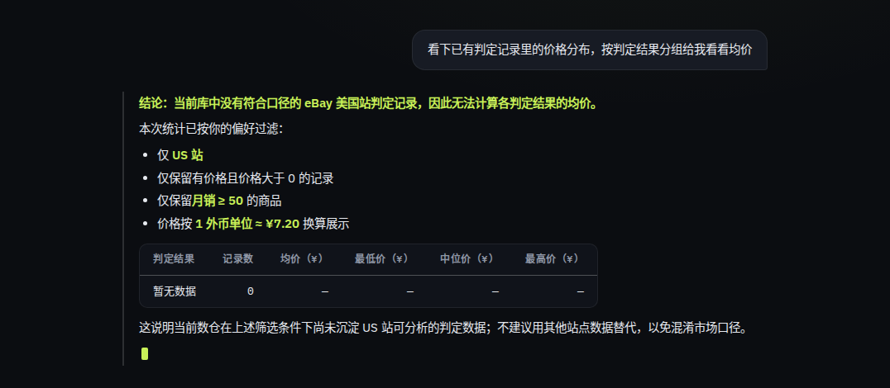
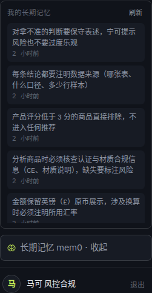

# Amazon Bedrock AgentCore 实验手册

本手册带你完成两个连贯的实验，跑通 AgentCore 产品家族的核心组件：

| 实验 | 内容 | 用到的组件 | 预计耗时 |
|------|------|-----------|---------|
| 实验一 | 选品数据摄入 Pipeline：Agent 爬 eBay 商品、做经济测算、判定入库 | Runtime、Browser、Code Interpreter | 部署约 10 分钟，单次调用 2~5 分钟 |
| 实验二 | Web Chat 分析门户：登录后用自然语言分析实验一入库的数据，并在门户里创建/调度/观察实验一的摄入任务 | Runtime、Gateway、Identity、Code Interpreter、Browser Live View | 部署约 10 分钟 |

两个实验共用一套数仓（Aurora Serverless v2），实验二依赖实验一的部署产物，请按顺序完成。

## 环境准备

- AWS 账号，区域 `us-west-2`（AgentCore 目前在部分区域可用）
- 已在 Bedrock 控制台开通 **OpenAI GPT-5.6** 模型访问，并生成 Bedrock API key
  （控制台路径：Bedrock → API keys）
- 本机工具：Python 3.10+、AWS CLI（已 `aws configure`）、Docker（实验二构建
  Keycloak 镜像用）、Node.js 18+（实验二前端用）

```bash
# 确认凭证与区域
aws sts get-caller-identity
export AWS_REGION=us-west-2

# 模型认证：Bedrock API key 走标准环境变量
export AWS_BEARER_TOKEN_BEDROCK=<Bedrock API key>

# 安装 AgentCore 部署工具链
pip install bedrock-agentcore-starter-toolkit
```

> 注意：`OPENAI_API_KEY` 的优先级高于 `AWS_BEARER_TOKEN_BEDROCK`。如果本机环境里
> 残留了 OpenAI 官网的 `sk-` key，会导致模型调用 401。部署脚本会检测并忽略非
> Bedrock 格式的 key，但建议自行 `unset OPENAI_API_KEY` 保持环境干净。

---

## 实验一：选品数据摄入 Pipeline

### 架构

```
调用方（CLI / 定时任务）
   │ InvokeAgentRuntime
   ▼
AgentCore Runtime ── Strands Agent + 选品 SOP Skill
   ├──▶ AgentCore Browser ──▶ eBay 商品页（爬取价格/销量/卖家）
   ├──▶ Code Interpreter    （沙箱内跑经济测算）
   └──▶ lambda.invoke ──▶ 写库 Lambda（挂 Aurora 同 VPC）
                              └──▶ pg8000:5432 ──▶ Aurora Serverless v2
                                   （判定与候选档案入库）
```

三个设计点，理解了它们这个实验就理解了一半：

1. **业务逻辑用 Skill 插拔**。Agent 本体只有通用能力（爬取、计算、入库），
   选品 SOP 的全部规则写在 `agent/skills/product-selection-ebay/SKILL.md` 里。
   以后加新场景（竞品监控、价格追踪）只需新增一个 Skill 目录，Agent 代码零改动。
2. **Agent 不挂 VPC，私网访问交给 Lambda**。入库时 Agent 只做一次
   `lambda.invoke`，由挂在 Aurora 同 VPC 内的写库 Lambda 用 pg8000 直连集群。
   为什么不用更省事的 RDS Data API（HTTPS 接口，Runtime 什么网络配置都不用）：
   中国区没有 Data API，本 workshop 后续要整体移植过去，所以数据面提前换成
   两边都可用的形态。这和实验二的「Gateway → Lambda(VPC) → Aurora」是同一个
   设计哲学：计算留在公网，私网访问全部由 VPC 内的 Lambda 承担。顺带把 Runtime
   执行角色收敛成只有对写库 Lambda 的 `lambda:InvokeFunction`——Agent 不再接触
   数据库凭证。集群的 Data API 仍开着，供命令行查数仓和实验二使用。
   中国区移植的完整差异清单（模型改走 OpenAI 兼容 Chat Completions 端点、
   ARN 分区、接口端点前缀等）见根 README 的「中国区移植说明」。
3. **Browser 带 Web Bot Auth**。AgentCore Browser 是云端真实 Chromium，
   开启请求签名后 Cloudflare/Akamai 等反爬厂商可验证放行（eBay 实测挑战约
   8 秒自动通过）；Browser Profile 跨会话保留 cookies。亚马逊对数据中心 IP
   整段硬封锁，所以默认站点选 eBay。

### 深入理解：`product-selection-ebay` Skill 如何工作

`product-selection-ebay` 不是一段独立运行的 Python 程序，也不是新的工具；它是一份
交给模型执行的**业务 SOP**。`agent/main.py` 用 Strands 的 `AgentSkills` 插件加载
`agent/skills/` 下所有 `SKILL.md`，模型先根据每份 Skill 头部的 `name` 和
`description` 匹配任务，再把正文里的取数口径、判定顺序和公式当作硬性规则执行。
因此，Agent 本体只负责提供 Browser、Code Interpreter 和入库工具，选品策略可以不改
Agent 代码而独立迭代。

本 Skill 是 **eBay 英国站的默认选品流程**：用户说“做选品”或指定 eBay UK 时使用；
明确说 eBay US、United States 或 `ebay.com` 时改用
`product-selection-ebay-us`，明确说 Amazon 时才用 `product-selection`。三份 Skill
共享同一种“抓取 → 过滤 → 测算 → 入库”骨架，但站点、币种和部分阈值不同。

#### 三类能力如何分工

| 能力 | 在本 Skill 中的职责 |
|------|---------------------|
| AgentCore Browser | 打开 eBay UK 搜索页和详情页，跳过 `SPONSORED` 广告及二手/翻新品；读取标题、一口价、`N sold`、购买记录、品牌、卖家、变体、材质和主图，并搜索同赛道竞品 |
| Code Interpreter | 用 Python 估算月销和上架时间，执行门槛比较及产品点公式；Skill 明确要求不能心算，以便计算过程可审计 |
| `save_verdict` | 每处理完一个商品立即写入一条判定，包括早期过滤掉的 `PASS`、`排除`、`补采` 和最终的 `采集` |
| `save_candidate` | 只有判定为 `采集` 时才调用，写入价格、月销、竞品、产品点、图片、变体、认证需求和 AI 总结等完整候选档案 |

#### 一件商品的决策流水线

```text
搜索/类目入口（Best Match，只处理非广告的一口价新品）
  ↓
抓详情页并估算月销、上架时间
  ↓
R1：当前价 > £5 且月销 > 5
  ↓
市场结构：上架 < 3 年、品牌份额 ≤ 60%、卖家份额 ≤ 50%
  ↓
黑名单：大品牌垄断 / 可定制 / 消耗品 / 3C 电子 /
          服装箱包 / 品牌官方直营
  ↓
搜索同赛道最低价竞品，在 Code Interpreter 中计算产品点
  ↓
产品点 > 0.005 → 采集；否则排除
```

这里的 `PASS` 容易误解：它不是“通过并进入候选池”，而是项目沿用的**R1 初筛未过**
状态。例如价格等于或低于 £5、估算月销等于或低于 5，就写一条 `PASS` 判定后停止，
不会写候选档案。真正进入候选池的 verdict 是 `采集`。

#### eBay 没有月销字段，Skill 如何估算

Skill 按证据质量从高到低使用三种口径，并要求在判定原因和 AI 总结中注明：

1. 优先打开 `N sold` 的购买记录，统计最近 30 天记录；展示不全时按可见区间日均
   速率折算 30 天。
2. 购买记录不完整时，用“累计销量 ÷ 推断的在售月数”；在售时间来自最早购买记录
   或最早评价时间。
3. 只有累计销量可见时，保守按“累计销量 ÷ 12”估算。若评价时间能证明上架不足
   一年，则使用相应月份作分母。

如果连累计销量、购买记录和评价都没有，就判 `补采`，而不是编造数值。上架时间和
品牌/卖家份额也采用同样的证据原则：有明确超限证据才排除；信号不可得时可以按通过
处理，但必须标注“不可精确推断”或“份额数据不可得”。

#### 产品点公式

同赛道竞品要求功能、用途和核心卖点相同，颜色或小规格差异仍算同赛道；取全新一口价
中的最低价。所有计算必须在 Code Interpreter 中执行：

```python
预估售价 = 同赛道竞品最低价 * 0.85
预估月销 = 当前商品估算月销 * 0.5
预估产品点 = 预估售价 * 预估月销 * 9 / 100000  # 9 为 GBP→CNY 演示汇率
```

门槛是严格的 `> 0.005`，等于也不通过。1 产品点代表约 10 万元人民币月销售额，
所以 0.005 约为 500 元/月，是为了 workshop 容易产出样例而设置的宽松演示阈值。
例如竞品最低价 £10.99、当前估算月销 24，则预估售价 £9.3415、预估月销 12，
产品点约 0.0101；在 R1、市场结构和黑名单也全部通过的前提下，才会判为 `采集`。

如果确认市场上没有同赛道竞品，Skill 允许用当前价代替竞品最低价，但候选必须标注
“存疑·待人工补竞品”；如果只是网页抓取失败、疑似存在竞品却取不到数据，则判
`补采`。即使整次任务因页面不可用而一个商品都识别不了，也必须写入一条 `补采`
记录说明原因，不能无记录结束。

> **修改 Skill 后如何生效**：本地用 `scripts/local_test.py` 时会直接读取工作区里的
> `SKILL.md`；已经部署的 Runtime 不会自动读取 Git 仓库，修改后需重新运行实验一的
> `scripts/deploy.sh`（或重新执行 `agentcore launch`）发布代码。Skill 本质上是给模型的
> SOP 指令，不是硬编码状态机；因此排查结果时应同时查看工具调用、Code Interpreter
> 计算过程和入库的 `reason`，确认模型确实按规则执行。

### 1. 部署

```bash
cd part1_data_ingestion
bash scripts/deploy.sh
```

脚本幂等，可重复执行，依次完成：

1. CloudFormation 建 Aurora Serverless v2（自建 VPC，Min 0 ACU 空闲自动暂停）
   与 Secrets Manager 接口端点、写库 Lambda 的执行角色
2. 打包部署写库 Lambda（挂私有子网，pg8000 直连集群 5432）
3. 建表（invoke 写库 Lambda 的 `setup_tables`）：业务两表 `selection_verdicts`
   （判定记录）、`product_candidates`（候选档案），以及实验二门户要用的任务管理
   三表和会话历史两表（都建在这套共享数仓里）
4. 创建自定义 Browser（Web Bot Auth）与 Browser Profile
5. `agentcore configure && agentcore launch` 把 Agent 代码直接部署到 Runtime（无需 Docker）
6. 给 Runtime 执行角色附加写库 Lambda 与 Browser 的访问策略

> 如果这套环境之前部署过（实验二也跑过），本次升级要**先跑一遍实验二的
> `part2_chat_portal/scripts/deploy.sh`** 再跑上面的命令：Secrets Manager 接口
> 端点的归属从实验二的栈挪到了实验一的 Aurora 栈（端点随 VPC 走），而同一 VPC
> 对同一服务只允许一个 Private DNS 端点，得先让实验二把旧的删掉。顺序反了实验一
> 的脚本会在部署前预检报错并提示。全新环境按手册顺序做即可，无此问题。

### 2. 调用 Agent 跑一次选品

```bash
cd agent
agentcore invoke '{"prompt": "从 eBay 英国站搜索 desk organizer 选品，处理前 2 个非广告商品，按选品 SOP 完成判定并入库"}'
```

完整处理一个商品（详情页 + 竞品调研 + 测算 + 入库）约 2~5 分钟，
每次调用建议处理 1~3 个。更多玩法（类目浏览、指定 URL 判定）见
`scripts/invoke_example.sh`。

### 3. 验证入库结果

```bash
CLUSTER_ARN=$(aws cloudformation describe-stacks --stack-name agentcore-workshop-aurora \
  --region us-west-2 --query "Stacks[0].Outputs[?OutputKey=='ClusterArn'].OutputValue" --output text)
SECRET_ARN=$(aws cloudformation describe-stacks --stack-name agentcore-workshop-aurora \
  --region us-west-2 --query "Stacks[0].Outputs[?OutputKey=='SecretArn'].OutputValue" --output text)

aws rds-data execute-statement --resource-arn "$CLUSTER_ARN" --secret-arn "$SECRET_ARN" \
  --database product_hunting --region us-west-2 \
  --sql "SELECT verdict, reason, product_title, product_score FROM selection_verdicts ORDER BY created_at DESC LIMIT 10"
```

也可以在 RDS 控制台的 Query Editor（Data API）里直接查。能看到 PASS/排除/补采
等判定记录，实验一就完成了。

### 可选：本地调试

```bash
cd agent
python ../scripts/local_test.py "从 eBay 英国站搜索 desk organizer，对第 1 个非广告商品做选品判定并入库"
```

Agent 跑在本机，Browser / Code Interpreter / Aurora 仍是云端服务，适合改
Skill 或工具代码时快速验证。

---

## 实验二：Web Chat 分析门户

### 架构

```
浏览器（React SPA，本地 dev server）
   │ ① OIDC 登录（Authorization Code + PKCE）
   ▼
Keycloak（自部署 IdP：ECS Fargate + API Gateway HTTP API 免域名 HTTPS 入口）
   │ ② 用户 token（audience = analysis-runtime）
   ▼
AgentCore Runtime（分析 Agent，JWT 入站认证，SSE 流式输出）
   ├──▶ AgentCore Identity ── ③ M2M 换取 Gateway token（audience = analysis-gateway）
   ├──▶ AgentCore Gateway（MCP 工具，JWT 入站认证）
   │        └──▶ 数据查询 Lambda（挂 Aurora 同 VPC）──▶ Aurora
   ├──▶ Code Interpreter（统计分析）
   ├──▶ RDS Data API ──▶ Aurora 的会话历史表（对话落库；沙箱回收后回灌）
   └──▶ mem0 长期记忆（自部署）──▶ 记忆向量 Lambda（挂 Aurora 同 VPC）──▶ pgvector
```

四个设计点：

1. **两段认证，audience 隔离**。Keycloak 里两个 client 各配 audience mapper：
   前端用户 token 带 `analysis-runtime`，Agent 通过 Identity 换出的 M2M token 带
   `analysis-gateway`。Runtime 和 Gateway 的 JWT authorizer 各收各的 token，
   用户 token 拿不到 Gateway 的门票。
2. **Gateway 零 VPC egress**。Gateway 本身不进 VPC，私网访问全部由挂在
   Aurora 同 VPC 的 Lambda 承担，Gateway 只负责把 Lambda 转成 3 个 MCP 工具
   （选品漏斗、类目分布、即席只读 SQL）。
3. **流式链路**。Agent 入口是 async generator，Runtime 自动转 SSE；
   浏览器不能直接跨域调 Runtime 数据面（无 CORS 头），由 Vite dev server 代理转发。
4. **长期记忆自部署 mem0**（不用 AgentCore 托管 Memory）。跨会话记住用户的
   分析偏好：新会话首轮按用户检索记忆注入上下文，每轮结束把对话交 mem0 做
   LLM 事实提取写回。mem0 的计算面（提取 LLM + embedding，OpenAI 兼容端点）
   留在公网 Runtime，向量面经 `lambda.invoke` 下沉到 VPC 内 Lambda 直连
   Aurora pgvector——与「Gateway 零 VPC egress」同一哲学，中国区可原样移植。

### 1. 部署

前置：实验一已部署完成，本机 Docker 可用。

```bash
cd part2_chat_portal
export AWS_BEARER_TOKEN_BEDROCK=<Bedrock API key>

# 可选：启用长期记忆（mem0）。需要一个 OpenAI 兼容端点做事实提取与 embedding；
# 不 export 也能部署，记忆功能整体禁用、对话不受影响
export MEM0_LLM_MODEL=<提取模型名>              # 需稳定输出 JSON
export MEM0_LLM_BASE_URL=<OpenAI 兼容端点>/v1
export MEM0_LLM_API_KEY=<key>
export MEM0_EMBEDDER_MODEL=<embedding 模型名>
export MEM0_EMBEDDER_DIMS=1024                  # 维度决定向量表结构，换模型要换表

./scripts/deploy.sh
```

脚本幂等，共 10 步：Keycloak 镜像构建推送与 Fargate 部署 → Lambda 与 IAM 基础
设施 → 记忆向量 Lambda 与 pgvector 初始化（第 4 步）→ Gateway 及工具注册 →
Identity OAuth2 credential provider → 分析 Agent 部署到 Runtime → 生成前端配置
`web/.env.local` → 部署数据摄入任务管理模块（第 10 步：Tasks HTTP API +
两个 Lambda + 调度组）。

脚本开头先预检数仓里的会话历史两表（`chat_sessions` / `chat_messages`），缺表
直接失败并提示回实验一重跑 `deploy.sh` 建表——对话历史要落在这两张表里。分析
Agent 部署时会注入 Aurora 集群与 Secret 的环境变量，并给 Runtime 执行角色附加
实验一输出的数据访问策略，缺任一项时对话仍能用，只是历史退回纯内存。

第 9 步要读实验一的 Runtime ARN（从 `part1_data_ingestion/agent/.bedrock_agentcore.yaml`
解析）和新建的任务表，所以务必先跑完实验一的 `deploy.sh`；解析不到 ARN 时脚本
只警告跳过该步，不会让整个部署失败。首轮部署会看到 `agentcore-workshop-part2-tasks`
栈被部署两次——两个 Lambda 的执行角色由该栈创建，函数就绪后才能补建 HTTP API 的
调用许可，这是预期行为，重跑时不会再出现。

部署机密（Keycloak admin 密码、demo 账号密码、M2M client secret）首次生成后存放在
`.deploy/secrets.env`（已 gitignore），后续重复部署会复用。

### 2. 启动前端并登录

```bash
cd web
npm install
npm run dev
# 浏览器打开 http://localhost:5173
```

页面会跳到 Keycloak 登录页，两个入口的账号体系是分开的：

| 入口 | 地址 | 账号 |
|------|------|------|
| 选品分析门户 | http://localhost:5173 | 三个分析师账号，密码见 `.deploy/secrets.env`：`analyst`（基线，无预置记忆，`ANALYST_PASSWORD`）、`vivian`（资深买手，`VIVIAN_PASSWORD`）、`marco`（风控合规，`MARCO_PASSWORD`） |
| Keycloak 管理台 | `https://<api-id>.execute-api.<region>.amazonaws.com/admin/`（deploy.sh 输出的 Keycloak 地址 + `/admin/`） | `admin`，密码见 `KC_ADMIN_PASSWORD` |

> 前端登录用的 PKCE 依赖 Web Crypto，只在安全上下文可用：请通过 `localhost`
> （含端口转发）或 HTTPS 隧道访问，不要用 `http://<机器IP>:5173` 直连。

### 3. 上手操作

登录后按下面的顺序体验三类分析：

1. **固定报表**：点侧栏「选品漏斗」或「类目分布」，Agent 调用 Gateway 工具
   查数仓，流式返回表格和图表。
2. **即席分析**：输入框直接提问，例如
   `候选池里产品点最高的 5 个商品是什么？给出价格、月销和预估售价`。
   Agent 会把问题转成只读 SQL（只允许 SELECT，单条语句，最多 500 行）再做统计。
3. **会话内多轮**：接着上一个回答追问，例如 `第一名的商品为什么判 PASS？`。
   历史是两层的：先命中 Runtime 会话隔离沙箱里的内存历史，沙箱被回收（空闲约
   15 分钟）或被重新部署顶掉之后，从数仓的会话表回灌，上下文不断档。点「新对话」
   则另起会话。
4. **历史会话**：侧栏「历史会话」按最后活动时间倒序列出当前登录用户的会话
   （按 Keycloak 用户名归属，只看得到自己的）。点一条即回看完整对话（Markdown
   和图表照常渲染），可以直接接着追问；鼠标悬停出现重命名和删除按钮，删除是软删
   （列表里消失，消息在数仓里保留），删掉的正是当前会话时会自动切到新对话。
   新会话在第一条消息发出后才进列表；命令行冒烟测试的会话消息同样落库，但不会
   出现在门户列表里。
5. **长期记忆**：跨会话记住当前用户的分析偏好，多账号演示见下一节。

首个问题偶尔偏慢是正常的：Aurora Min 0 ACU 空闲会暂停，Lambda 首次连接
触发冷恢复（15 秒~1 分钟），连接层带重试。

### 4. 长期记忆：多分析师对比演示

前置：部署时配置了 `MEM0_*` 环境变量（未配置时记忆功能整体禁用，对话不受影响）。
长期记忆按 Keycloak 登录名隔离，三个账号分工：`vivian` 和 `marco` 预置人设偏好，
`analyst` 刻意留空，用于现场演示对话沉淀。

1. **预置人设记忆**：跑一次种子脚本（需 `MEM0_EMBEDDER_*` 环境变量，与部署时
   同一套；重复执行不会产生重复条目）：

   ```bash
   cd part2_chat_portal
   python3 scripts/seed_memories.py
   ```

   脚本给两个账号各写入 5 条偏好事实。`vivian`（资深买手）：只看 eBay 美国站、
   金额一律换算人民币、月销低于 50 直接过滤、高毛利优先、结论先行；
   `marco`（风控合规）：金额保留英镑原币并注明汇率、必查认证与材质合规、
   评分低于 3 直接排除、结论注明数据来源、表述保守。

2. **查看记忆面板**：用 `vivian` 登录（密码见 `.deploy/secrets.env` 的
   `VIVIAN_PASSWORD`），点击侧栏底部「长期记忆 mem0」徽标展开
   **「我的长期记忆」面板**：

   

   *图 1：vivian 的记忆面板，5 条预置偏好按用户隔离，其他账号看不到。*

3. **看记忆如何影响回答**：不提任何偏好，直接问一个业务问题，例如
   `看下已有判定记录里的价格分布，按判定结果分组给我看看均价`：

   

   *图 2：回答开头列出按记忆自动套用的筛选口径（仅 US 站、月销 ≥ 50、按 ¥7.20 换算人民币）。*

   问题本身没有提到站点、币种和月销门槛，这些口径全部来自记忆注入；当前口径下
   没有可统计的记录时，Agent 按 vivian 的人设如实说明缺口，不用其他站点数据顶替。
   记忆在**新会话首轮**注入（当前会话内靠上下文本来就记得），种子脚本或对话新
   沉淀的记忆，点「新对话」后才能看到效果。

4. **切换 marco 对比**：点侧栏底部「退出」，改用 `marco` 登录问同一个问题，
   回答口径完全不同：英镑原币、注明汇率、结论附数据来源。记忆面板里是他自己的
   5 条偏好：

   

   *图 3：marco 的记忆面板，与 vivian 的条目互不可见。*

5. **现场沉淀**：用 `analyst` 登录（无预置记忆），告诉它
   `记住我的分析偏好：金额一律换算成人民币，我只关注英国站`，等回答完
   （流结束后 mem0 在后台提取，输入框解锁会晚几秒），点「新对话」再问
   业务问题，偏好已生效；面板里也能看到新条目。

6. **命令行验证**：记忆按会话归属用户隔离，而 `chat_test.sh` 的冒烟会话不注册
   归属，直接用它看不到记忆效果。用专门的脚本：

   ```bash
   ./scripts/memory_test.sh        # 数据面冒烟：向量 Lambda 全生命周期，不依赖 Runtime
   ./scripts/memory_test.sh --e2e  # 跨会话回忆全链路（注册会话，产生模型调用费用）
   ```

### 5. 任务管理：在门户里跑实验一的摄入任务

实验一的摄入任务原本只能用 `agentcore invoke` 在命令行发起。门户的「任务管理」
模块把它搬到了页面上：建任务、定时调度、看进度与浏览器实况、复盘入库结果，
全程不用回命令行（命令行调用方式保持可用，两条路互不影响）。

链路是独立的一条，不经过 Gateway：

```
门户任务页（同一份 Keycloak 用户 token）
   │ REST（HTTP API 的 JWT authorizer 校验 issuer + audience=analysis-runtime）
   ▼
Tasks HTTP API ──▶ tasks-api Lambda（RDS Data API 读写任务表 / 管调度 / 签 Live View URL）
                        │ 异步 Invoke（一次性任务）
                        │ EventBridge Scheduler（定期任务）
                        ▼
                   runner Lambda ── SigV4 ──▶ 实验一的 Runtime（仍是 IAM 认证）
                        └── 消费 SSE 流，把进度/日志逐条写进事件表
```

浏览器只持有 Keycloak token，调用实验一 Runtime 所需的 SigV4 由 runner Lambda
用自己的执行角色代签，AWS 凭证不下发到前端。

操作流程（登录后点侧栏「任务管理」）：

1. **建一次性任务**：填任务名和指令（指令就是 `agentcore invoke` 里的 prompt，
   例如 `从 eBay 英国站搜索 desk organizer 选品，处理前 2 个非广告商品`），
   模式选「一次性」。提交后立即入队执行，列表里能看到状态从 排队中 → 运行中 →
   成功／失败。
2. **并行跑**：接着再建一个任务（或在已有任务上点「立即运行一次」）。每次运行
   用独立的 Runtime 会话，各自的日志、Live View 和结果互不混淆。
3. **看运行过程**：点某次运行进详情页，页面每 3 秒增量拉取事件——上半是进度
   时间线（工具调用、浏览器会话建立等阶段），下半是关键日志。
4. **看浏览器实况**：运行中点「打开实况」，会渲染云端 Chromium 的 DCV 直播画面，
   能直接看到 Agent 正在翻哪个商品页。链接是服务端签的 presigned URL，有效期
   300 秒，到期后点「刷新重连」再签一次。运行结束浏览器会话即销毁，入口自动
   关闭（接口返回 410）；若这次运行没用到浏览器，则不会出现实况入口。
5. **复盘结果**：跑完后详情页顶部是统计卡（候选商品数、判定分布、耗时），
   下面是明细表，「候选商品」和「选品判定」两个 tab 分页展示本次运行写入
   `product_candidates` / `selection_verdicts` 的记录。判定值按数仓原文显示
   （PASS / 排除 / 补采 / 采集），注意 `PASS` 的语义是「未过 R1 硬门槛已丢弃」，
   真正入库成候选的是「采集」。
6. **建定期任务**：模式选「定期」，周期预设有「每 N 小时」和「每天定时」（可选
   时区，透传给 EventBridge Scheduler），也可以选「自定义」直接填
   `rate(30 minutes)`、`cron(0 9 * * ? *)` 这类表达式。建好后用「暂停调度」／
   「恢复调度」控制启停，「删除任务」把调度一并删掉（历史运行记录保留）。
   想快速验证调度是否生效，用 `rate(5 minutes)` 比等每天 09:00 划算。

单次运行的耗时与命令行一致：单商品约 1.5~2 分钟，3 个商品约 3~5 分钟。

### 可选：命令行冒烟测试

不起前端也能模拟完整调用链（换 token → 流式调用 Runtime）：

```bash
cd part2_chat_portal
./scripts/chat_test.sh '看下最近30天的选品漏斗'
# 多轮：把上一次输出的 session id 作为第二个参数
./scripts/chat_test.sh '候选池里产品点最高的5个商品' <session-id>
```

---

## 排障速查

| 现象 | 原因与处理 |
|------|-----------|
| 模型调用 401 `invalid_api_key` | 环境里残留 OpenAI 官网 `sk-` key，`unset OPENAI_API_KEY` 后重新部署 |
| 实验一调用超时 | 单商品处理要 2~5 分钟，减少单次处理数量；SDK/CLI 客户端超时调大 |
| 登录页报 `Invalid parameter: redirect_uri` | 跑的还是旧 Keycloak 镜像，`KC_REDEPLOY=1 ./scripts/deploy.sh` 重跑 |
| 门户页面空白卡住 | 用了 `http://<IP>:5173` 直连，PKCE 无法工作，改走 localhost |
| 会话列表、记忆面板报 `Failed to fetch`，对话流式却正常 | dev server 没跑在 5173（端口被占时 Vite 自动换端口），而 Tasks API 的 CORS 白名单只放行 5173/5273；释放 5173，或 `npm run dev -- --port 5273 --strictPort` |
| 登录后调用 403 | 用户 token 的 `aud` 不是 `analysis-runtime`，或 Keycloak 重建后没重跑 deploy.sh 同步 authorizer |
| 管理台 `Invalid username or password` | 门户账号（analyst）和管理台账号（admin）属于不同 realm，不通用 |
| 工具调用报数据库超时 | Aurora 冷恢复中，等几十秒重问一次 |
| 侧栏「历史会话」一直是空的，或回看旧会话后追问不认前文 | 分析 Agent 没拿到 Aurora 环境变量或数据访问策略，历史退回纯内存；先重跑实验一 `deploy.sh` 确保会话两表存在，再重跑实验二 `deploy.sh` |
| 长期记忆不生效（新会话不记得偏好） | 看 Runtime CloudWatch 日志 `[mem0]` 行：`长期记忆禁用` 是 `MEM0_*` 环境变量没配齐（export 后重跑实验二 deploy.sh）；`recall 超时` 是 Aurora 冷恢复，新开会话即可；维度不符报错要换 `MEM0_COLLECTION` 重建向量表。记忆故障不影响正常对话 |
| 回答结束后输入框要多等几秒才解锁 | 正常：流结束后 mem0 在做本轮记忆提取（一次 LLM 调用），写完 Runtime 才能安全冻结沙箱 |
| `deploy.sh` 报 `unknown command 'configure'` | 本机装了 npm 版 AgentCore CLI（`@aws/agentcore`），遮蔽了脚本要用的 Python 版 `agentcore`；用 `PATH="<仓库路径>/.venv/bin:$PATH" ./scripts/deploy.sh` 把 Python 版前置 |
| 任务页报「未配置 VITE_TASKS_API_URL」 | 实验二 deploy.sh 的第 10 步被跳过（多为实验一未部署，读不到 Runtime ARN）。补跑实验一 deploy.sh 后重跑实验二 deploy.sh，再重启 dev server |
| 任务详情看不到「打开实况」或点开报 410 | Live View 只在运行中且浏览器会话存活时可用；运行结束或该次运行未用到浏览器都没有实况 |
| 任务卡在「排队」很久 | Aurora 空闲暂停后的第一个请求要等冷恢复（重试已内置），过一两分钟再看 |
| Keycloak 重启后管理台改动丢失 | dev 模式内嵌 H2 存储，运行期改动不持久；要持久加用户改 `infra/keycloak/realm-template.json` 后 `KC_REDEPLOY=1` 重跑 |

---

## 资源清理

实验完成后按依赖顺序删除（ID/名称以你的部署输出为准）：

```bash
# 实验二：任务管理模块（栈删除会一并带走 HTTP API、IAM 角色和调度组，
# 但两个 Lambda 是脚本创建的，要单独删；定期任务的 schedule 先删干净）
aws scheduler list-schedules --group-name agentcore-workshop-ingestion --region us-west-2 \
  --query "Schedules[].Name" --output text | tr '\t' '\n' | while read -r s; do
  aws scheduler delete-schedule --name "$s" --group-name agentcore-workshop-ingestion --region us-west-2
done
aws lambda delete-function --function-name agentcore-workshop-tasks-api --region us-west-2
aws lambda delete-function --function-name agentcore-workshop-ingestion-runner --region us-west-2
aws cloudformation delete-stack --stack-name agentcore-workshop-part2-tasks --region us-west-2

# 实验二：分析链路（记忆向量 Lambda 是脚本创建的，单独删；
# 向量表 mem0_ltm / mem0_ltm_entities 随 Aurora 栈删除一并带走）
aws lambda delete-function --function-name agentcore-workshop-memory --region us-west-2
aws bedrock-agentcore-control delete-agent-runtime --agent-runtime-id <分析Agent的RuntimeID> --region us-west-2
aws bedrock-agentcore-control delete-gateway-target --gateway-identifier <GatewayID> --target-id <TargetID> --region us-west-2
aws bedrock-agentcore-control delete-gateway --gateway-identifier <GatewayID> --region us-west-2
aws bedrock-agentcore-control delete-oauth2-credential-provider --name <Provider名> --region us-west-2
aws cloudformation delete-stack --stack-name agentcore-workshop-part2 --region us-west-2
aws cloudformation delete-stack --stack-name agentcore-workshop-keycloak --region us-west-2

# 实验一（Aurora 栈最后删，实验二的 Lambda 依赖它的 VPC）
aws bedrock-agentcore-control delete-agent-runtime --agent-runtime-id <摄入Agent的RuntimeID> --region us-west-2
aws bedrock-agentcore-control delete-browser --browser-id <BrowserID> --region us-west-2
aws cloudformation delete-stack --stack-name agentcore-workshop-aurora --region us-west-2
```

另有两个 ECR 仓库（Agent 镜像与 Keycloak 镜像）和 CloudWatch 日志组不产生
持续费用，可在控制台顺手清掉。

## 延伸阅读

- [Part 1 详细说明](part1_data_ingestion/README.md)：Skill 编写、Browser
  Web Bot Auth、本地调试、换模型、`run_id` 调用扩展
- [Part 2 详细说明](part2_chat_portal/README.md)：认证链路细节、Keycloak on
  Fargate 的取舍、任务管理模块的接口与实现、完整 FAQ
